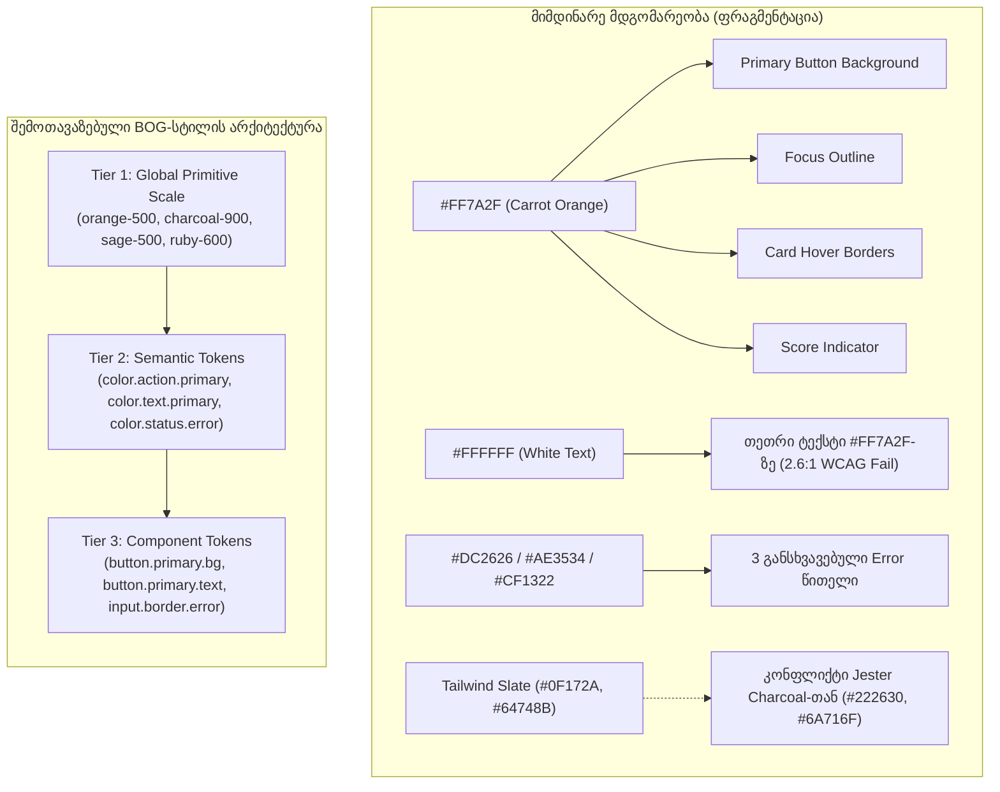
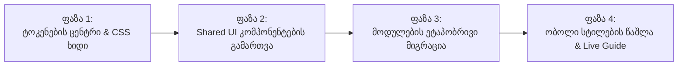

# JESTER Frontend დიზაინ-სისტემისა და სტილების ცენტრალიზაციის დეტალური აუდიტი

**დოკუმენტის სტატუსი:** კვლევითი ანგარიში და არქიტექტურული წინადადება (Audit & Architectural Roadmap)  
**თარიღი:** 2026 წლის ნოემბერი  
**მიზანი:** JESTER-ის frontend-ის სტილების ცენტრალიზება, არსებული ვიზუალური ფრაგმენტაციის აღმოფხვრა და ერთიანი, ტოკენებზე დაფუძნებული დიზაინ-სისტემის ჩამოყალიბება (საორიენტაციო ეტალონი: BOG Design System მოდელი).  
**რეჟიმი:** მკაცრად კვლევითი — აპლიკაციის კოდი, დიზაინი და კონფიგურაცია ამ ეტაპზე ხელუხლებელია.

---

## 1. მოკლე შეფასება (Executive Summary)

JESTER-ის frontend-ის სიღრმისეულმა აუდიტმა გამოავლინა მკაფიო კონტრასტი **დამტკიცებულ დიზაინ-ფილოსოფიასა** (`docs/design/JESTER_COLOR_DESIGN_SYSTEM_V1.md`) და **ფაქტობრივ იმპლემენტაციას** შორის:

1. **ვიზუალური მნიშვნელობების მასიური გაფანტვა (Proliferation):**
   - კოდბაზაში დაფიქსირდა **332 განსხვავებული უნიკალური HEX ფერი**.
   - ბრენდის მთავარი სტაფილოსფერი აქცენტი (`#FF7A2F` და მისი ვარიაციები `#E9681F`, `#C95618`, `#9E4215`) **172-ჯერ არის პირდაპირ hardcode-ით ჩაწერილი** CSS და TSX ფაილებში.
   - არსებობს ორი ერთმანეთის კონკურენტი ნეიტრალური პალიტრა: **Warm Paper Editorial** (`#FAF7F2`, `#F3EEE6`, `#222630`, `#6A716F`) და **Cool Slate SaaS** (`#F8FAFC`, `#E2E8F0`, `#CBD5E1`, `#0F172A`, `#64748B`), რაც ეკრანებს შორის ვიზუალურ გაორებას ქმნის.
2. **სტილების მართვის ჰიბრიდული და კონფლიქტური ფენები:**
   - კოდბაზაში თანაარსებობს 4 განსხვავებული მიდგომა: (1) 9,836 ხაზი გლობალური/მოდულური CSS (13 ფაილი), (2) 1,201 ინლაინ `style={{...}}` ჩანაწერი, (3) TypeScript დიზაინ ტოკენები (`frontend/src/ui/tokens/`), (4) Tailwind/NativeWind კონფიგურაცია, რომელიც პრაქტიკულად მხოლოდ ერთ სატესტო გვერდზე გამოიყენება.
3. **კომპონენტების დუბლირება და გათიშულობა:**
   - არსებობს ორი პარალელური UI ბიბლიოთეკა: `frontend/src/shared/ui/` (სადაც რეალური აპლიკაცია მუშაობს) და `frontend/src/ui/primitives/` (React Native Web-ზე დაფუძნებული პრიმიტივები, რომლებიც **მხოლოდ `/visual-lab`-შია იმპორტირებული**).
   - ამავდროულად, კოდში 190 ადგილას გამოყენებულია raw HTML `<button>`, 27 ადგილას `<input>` და 9 ადგილას `<select>` საერთო კომპონენტების გვერდის ავლით.
4. **ხელმისაწვდომობისა და კონტრასტის დარღვევები:**
   - მიუხედავად იმისა, რომ დიზაინ-სპეციფიკაციაში მკაფიოდ არის აკრძალული თეთრი ტექსტი `#FF7A2F` სტაფილოსფერზე (კონტრასტი მხოლოდ 2.60:1, WCAG AA მოითხოვს მინიმუმ 4.5:1-ს), ავტორიზაციის, რეგისტრაციისა და ონბორდინგის ღილაკები კვლავ იყენებენ თეთრ ტექსტს სტაფილოსფერ ფონზე.
5. **გამოსავალი და სტრატეგია:**
   - JESTER-ისთვის ჩვენი საარქიტექტურო წინადადებაა **3-დონიანი ტოკენების სისტემა (შთაგონებული BOG Design System-ის ორგანიზების პრინციპით** (Primitives → Semantics → Components)**.
   - რეალური ვებ-აპლიკაციისთვის ოპტიმალურია სუფთა **CSS Variables + TypeScript ტიპიზებული ტოკენების ხიდი**, რათა ბრენდის ნებისმიერი ცვლილება ერთ წერტილში განხორციელდეს და მომენტალურად აისახოს მთელ სისტემაზე, ისე რომ სისტემური (error, success, warning) ფერები დარჩეს სრულიად დამოუკიდებელი.

---

## 2. პროექტის კონტექსტი და ტექნოლოგიური სტეკი

### 2.1 რეალური ტექნოლოგიური სტეკი

| შრე | რეალური ტექნოლოგია | სტატუსი კოდბაზაში |
| :--- | :--- | :--- |
| **Framework** | React 19 (`react` / `react-dom` 19.2.8) + Vite 8.2 | აქტიური, წარმოების სტანდარტი |
| **Language** | TypeScript (~6.0.2) | მკაცრი ტიპიზაცია (`tsc` გადის 0 შეცდომით) |
| **Styling Runtime** | Vanilla CSS (ფაილური სტილები) + Inline React Styles | მთავარი მამოძრავებელი ძალა |
| **Utility Framework** | Tailwind CSS + NativeWind 4.2.6 + PostCSS | დაინსტალირებულია, მაგრამ რეალურ აპლიკაციაში იშვიათად გამოიყენება |
| **Cross-Platform Bridge** | `react-native-web` 0.21.2 | გამოიყენება **მხოლოდ `frontend/src/ui/primitives` და `/visual-lab`-ში**; რეალურ მოდულებში არცერთ ფაილში არ გამოიყენება |
| **Routing** | React Router v7 (`react-router-dom` 7.18.3) | ცენტრალიზებული `AppRoutes.tsx` |
| **Server State** | TanStack React Query v5 | ქეშირება, მუტაციები, ინვალიდაცია |
| **Fonts** | Noto Sans Georgian (Weights: 300-900 WOFF2) | ლოკალური შრიფტები `/public/fonts/` |

### 2.2 ძირითადი გვერდები და სტრუქტურა

```text
frontend/src/
├── core/                  # ავტორიზაცია, API კლიენტი, Realtime, კონფიგურაცია
├── shared/                # AppShell, ნავიგაცია, სტატუსები, საერთო UI კომპონენტები
│   └── ui/                # რეალური საერთო UI ბიბლიოთეკა (Button, Card, Input, Badge, etc.)
├── ui/                    # ექსპერიმენტული UI ლაბორატორია (VisualLab, Primitives, Tokens)
│   ├── primitives/        # React Native Web პრიმიტივები (პარალელური, გათიშული შრე)
│   └── tokens/            # TypeScript ტოკენები (colors, typography, spacing, radii, etc.)
└── modules/               # ფუნქციური მოდულები და ეკრანები:
    ├── auth/              # LoginPage, RegisterPage, ResetPasswordPage
    ├── onboarding/        # BirthDataOnboardingPage + ProfileEnrichmentModule
    ├── home/              # HomePage (Daily Energy, Do/Don't, Insights, New People)
    ├── discover/          # DiscoverPage (Deck, Swipe, Filters)
    ├── people/            # PersonProfilePage, SocialIdentity
    ├── compatibility/     # ComparePage, WhyPage, DeepAnalysisSection
    ├── connections/       # ConnectionsPage
    ├── chat/ & messages/  # ChatPage, MessagesPage
    ├── me/                # MePage (პირადი ასტროლოგიური პროფილი)
    ├── wallet/            # WalletModal (Stars Economy)
    └── inspector/         # ContentInspectorPage (დეველოპერული აუდიტის ხელსაწყო)
```

### 2.3 დამტკიცებული დიზაინ-გადაწყვეტილებები (Ground Truth)

`docs/design/JESTER_COLOR_DESIGN_SYSTEM_V1.md` და Founder Decision Records-ის მიხედვით:
1. **პროდუქტის არსი:** JESTER არ არის გაცნობის აპლიკაცია (Tinder-კლონი) და არც ჰოროსკოპის სტანდარტული დაფა. ის არის ურთიერთობების ინტელექტის ძრავი (**ME → YOU → US → MORE PEOPLE**).
2. **ბრენდის იდენტობა:**
   - **Primary Accent:** Vivid Clean Carrot Orange (`#FF7A2F`).
   - **Surfaces:** Warm pale paper tones (`#FAF7F2`, `#F3EEE6`, `#FFFDFA`).
   - **Text:** Deep charcoal (`#222630`), editorial slate (`#6A716F`, `#8B918F`).
   - **Support:** Measured Sage (`#788A69`, `#4B6242`) და Soft Peach (`#FBEEE7`, `#F5DDD1`).
   - **Monetization:** Stars Economy (Gold/Amber პალიტრა: `#FEF3C7`, `#FDE68A`, `#92400E`).
3. **კონტრასტისა და ხელმისაწვდომობის კანონი:**
   - ნათელ `#FF7A2F` ღილაკზე **სავალდებულოა `#222630` მუქი ტექსტი (5.82:1 კონტრასტი)**.
   - თეთრი ტექსტი დასაშვებია მხოლოდ მუქ სტაფილოსფერზე (`#9E4215`, 6.47:1).
4. **ტიპოგრაფია:**
   - ქართულ ტექსტებზე სავალდებულოა **Noto Sans Georgian**.
   - მინიმალური ზომა მობილურზე: 12px (ფორმის ველებში iOS zoom-ის თავიდან ასაცილებლად — 16px).
   - Touch Target: მინიმუმ 44x44px.

---

## 3. სტილების არქიტექტურა და პრობლემების ანალიზი

### 3.1 სტილების ფაილების ინვენტარი და სტატუსი (CSS Categorization)

სტილები დაყოფილია გამოყენების არეალის მიხედვით:

#### ა. მოქმედ აპლიკაციაში (Production Screens) აქტიურად გამოყენებული სტილები
| CSS ფაილი | ხაზები | ცვლადები (Def/Used) | Hardcoded HEX | !important | გამოყენების არეალი |
| :--- | :--- | :--- | :--- | :--- | :--- |
| index.css | 1,368 | colors.css-ის იმპორტი + გლობალური layout | 81 | 1 | მთელი აპლიკაცია (გლობალური Shell, Layout, Reset, Typography) |
| colors.css | 185 | 115 ცვლადი | ცენტრალური ტოკენები | 0 | **ცენტრალური ფერების რეესტრი** (ერთადერთი წყარო) |
| modules/home/homeRebuild.css | 1,646 | 0 / 11 | 48 | 0 | HomePage.tsx (აქტიური მთავარი გვერდი) |
| modules/home/home.css | 1,555 | 0 / 30 | 79 | 2 | HomePage.tsx (დუბლირებადი ნაწილები) |
| modules/onboarding/steps/interests.css | 1,303 | 0 / 0 | 200 | 0 | ონბორდინგის V2/V3 ეტაპები (ინტერესები, პიროვნება, მიზნები) |
| modules/people/person-profile.css | 537 | 0 / 0 | 66 | 0 | ადამიანის პროფილის ბარათები |
| modules/wallet/wallet.css | 313 | 0 / 0 | 41 | 0 | Stars საფულე და Ledger |
| modules/auth/login.css | 303 | 2 / 4 | 34 | 0 | ავტორიზაციის გვერდი |
| modules/auth/registration.css | 293 | 9 / 52 | 59 | 0 | რეგისტრაციის გვერდი და ვალიდაცია |
| modules/discover/discovery.css | 85 | 0 / 30 | 6 | 1 | აღმოჩენის დეკი (Deck) |
| modules/chat/messaging.css | 69 | 0 / 33 | 0 | 2 | შეტყობინებები და ჩატი |
| modules/people/social-profile.css | 56 | 0 / 34 | 0 | 0 | SocialIdentity კომპონენტი |
| modules/people/connection-actions.css | 12 | 0 / 12 | 0 | 0 | კავშირის მოქმედების ღილაკები |

#### ბ. მხოლოდ სატესტო / ლაბორატორიულ გარემოში (/visual-lab) გამოყენებული სტილები
- rontend/src/ui/primitives/* (React Native Web-ზე დაფუძნებული კომპონენტები: Box, Text, Button, Card, Input და ა.შ.).
- rontend/src/ui/tokens/* (TypeScript-ში გაწერილი ტოკენები, რომლებიც მხოლოდ RNW პრიმიტივებშია იმპორტირებული).
- არცერთი მათგანი არ გამოიყენება მოქმედ პროდუქტიულ ეკრანებზე (/home, /onboarding, /discover, /chat, /me).

#### გ. სავარაუდოდ გამოუყენებელი / ობოლი (Dead / Orphaned) სტილები
- modules/home/homeEditorial.css (2,206 ხაზი, 245 hardcoded ფერი, 7 !important) — **არცერთ TSX/TS ფაილში არ არის იმპორტირებული**. წარმოადგენს ადრეული ექსპერიმენტის ნარჩენს. (დარჩენილია ხელუხლებლად, არ არის წაშლილი).

### 3.2 მთავარი არქიტექტურული ხარვეზები

#### ხარვეზი 1: ობოლი და დუბლირებული სტილების ფურცლები (Dead / Duplicate CSS)
- `homeEditorial.css` (2,206 ხაზი) ინახება რეპოზიტორიაში, შეიცავს 245 hardcoded ფერს და 7 `!important` წესს, მაგრამ **არცერთ კომპონენტში არ არის იმპორტირებული**. ის წარმოადგენს ადრეული ექსპერიმენტის ნარჩენს.
- `HomePage.tsx` ერთდროულად აიმპორტებს `home.css`-საც (1,555 ხაზი) და `homeRebuild.css`-საც (1,646 ხაზი). ორივე ფაილი აღწერს ერთსა და იმავე სექციებს (Daily Energy, Insights, New People), რაც იწვევს კლასების კონფლიქტებსა და წესების გადაფარვას.

#### ხარვეზი 2: ლოკალურად გადატვირთული `:root` სკოპები
- `frontend/src/index.css` განსაზღვრავს გლობალურ `--jester-*` ცვლადებს (ხაზები 75-168).
- `frontend/src/modules/home/home.css` თავის მხრივ ხსნის ახალ `:root` ბლოკს (ხაზები 5-34) და ხელახლა განსაზღვრავს `--home-brand-orange`, `--home-bg-canvas`, `--home-text-primary`, `--home-radius-card` ცვლადებს.
- `registration.css` და `login.css` ქმნიან საკუთარ ლოკალურ ცვლადებს: `--registration-orange`, `--login-orange`.

#### ხარვეზი 3: ინლაინ სტილების მასიური სიჭარბე (1,201 Inline Styles)
- კოდბაზაში დაფიქსირდა **1,201 ინლაინ `style={{...}}` ჩანაწერი**.
- მაგალითად, `BirthDataOnboardingPage.tsx`-სა და `BirthDateStep.tsx`-ში თითქმის ყველა კონტეინერი, სათაური, ფერის ინდიკატორი და ღილაკი პირდაპირ ინლაინ JS ობიექტით არის გაფორმებული.
- ეს სრულიად გამორიცხავს ბრენდის ფერების ცენტრალიზებულ ცვლას: CSS ფაილში ცვლადის შეცვლა ინლაინ სტილებზე გავლენას ვერ ახდენს.

#### ხარვეზი 4: გათიშული UI ბიბლიოთეკები (`shared/ui` vs `ui/primitives`)
- `frontend/src/ui/primitives/` შეიქმნა React Native Web-ის ბაზაზე (ViewStyle, Pressable), იყენებს `frontend/src/ui/tokens/`-ს, მაგრამ **გამოიყენება მხოლოდ `VisualLab.tsx`-ში**.
- რეალური პროდუქტი იყენებს `frontend/src/shared/ui/`-ს, სადაც კომპონენტებს (`Button.tsx`, `Card.tsx`, `Badge.tsx`, `Input.tsx`) შიგნით უწერიათ **საკუთარი hardcoded HEX ფერები** და არ იყენებენ არც `tokens.ts`-ს და არც CSS Variables-ს!

---

## 4. ვიზუალური მნიშვნელობების დეტალური ინვენტარი

### 4.1 ფერები (Color Inventory)

კოდბაზაში აღმოჩენილია **332 უნიკალური HEX კოდი**. ქვემოთ მოცემულია მათი დაჯგუფება სემანტიკური კატეგორიების მიხედვით:

#### ა. ბრენდის სტაფილოსფერი აქცენტი (Brand Orange Proliferation)
| HEX მნიშვნელობა | რაოდენობა | სად გვხვდება | შეუსაბამობა / პრობლემა |
| :--- | :--- | :--- | :--- |
| `#FF7A2F` | 81 | `index.css`, `shared/ui/Button.tsx`, `Card.tsx`, `home.css`, `login.css` | დამტკიცებული Orange 500, მაგრამ hardcoded-ია 81 ადგილას |
| `#E9681F` | 31 | `interests.css`, `interests.tsx`, `Button.tsx`, `home.css` | Orange 600 (Hover/Active); ხშირად გამოიყენება როგორც primary |
| `#9E4215` | 38 | `Input.tsx`, `registration.css`, `Badge.tsx`, `index.css` | Orange 800 (Dark focus ring & score text) |
| `#C95618` | 22 | `Button.tsx`, `registration.css`, `index.css` | Orange 700 (Pressed state) |
| `#FF4D4F` | 11 | `homeEditorial.css`, `home.css` | შემთხვევითი წითელ-ნარინჯისფერი |
| `#F16417` | 3 | `login.css`, `registration.css` | გრადიენტის შიდა წერტილი |
| `#EA580C`, `#F97316` | 6 | `interests.css`, `inspector` | Tailwind-ის ნარინჯისფერი, ბრენდთან აცდენილი |
| `#D95710`, `#F96915` | 2 | `interests.css` | თვითნებური hover ფერები |

#### ბ. ძირითადი ტექსტი და მელანი (Dark Neutrals / Text)
| HEX მნიშვნელობა | რაოდენობა | სად გვხვდება | შეუსაბამობა / პრობლემა |
| :--- | :--- | :--- | :--- |
| `#222630` | 113 | `index.css`, `shared/ui/*`, `registration.css`, `home.css` | დამტკიცებული Brand Ink (Primary Text) |
| `#0F172A` | 97 | `interests.css`, `InterestsStep.tsx`, `shadows.ts` | **Tailwind Slate 900** — კონფლიქტშია `#222630`-თან! |
| `#1E293B` | 41 | `interests.css`, `PersonalityStep.tsx` | **Tailwind Slate 800** |
| `#000000` / `#000` | 5 | `login.css`, `index.css` | აბსოლუტური შავი |
| `#272C36`, `#1F242E` | 7 | `home.css`, `homeEditorial.css` | მიკრო-ვარიაციები `#222630`-ის ნაცვლად |

#### გ. მეორეული ტექსტი და რუხი ტონები (Secondary & Muted)
| HEX მნიშვნელობა | რაოდენობა | სად გვხვდება | შეუსაბამობა / პრობლემა |
| :--- | :--- | :--- | :--- |
| `#64748B` | 151 | `interests.css`, `ProfileEnrichmentModule.tsx`, `tokens` | **Tailwind Slate 500** (ყველაზე ხშირი მეორეული ფერი) |
| `#6A716F` | 30 | `index.css`, `shared/ui/Input.tsx`, `Badge.tsx` | დამტკიცებული Editorial Slate (`--jester-text-secondary`) |
| `#5A626F` | 42 | `home.css`, `homeRebuild.css` | კიდევ ერთი დამოუკიდებელი მუქი რუხი |
| `#94A3B8` | 46 | `interests.css`, `BirthDateInput.tsx` | **Tailwind Slate 400** |
| `#8B918F`, `#8F8A83` | 14 | `index.css`, `shared/ui/Input.tsx` | დამტკიცებული Muted & Interactive Border |
| `#878E99`, `#9C978F` | 10 | `home.css`, `registration.css` | თვითნებური შუალედური რუხები |

#### დ. ზედაპირები და ფონები (Surfaces & Backgrounds)
| HEX მნიშვნელობა | რაოდენობა | სად გვხვდება | შეუსაბამობა / პრობლემა |
| :--- | :--- | :--- | :--- |
| `#FFFFFF` / `#FFF` | 188 | მთელ პროექტში | ბარათების და ველების ფონი |
| `#E2E8F0` | 69 | `interests.css`, `ProfileEnrichmentModule.tsx` | **Tailwind Slate 200** (საზღვრები) |
| `#F8FAFC` | 46 | `interests.css`, `BirthDateInput.tsx` | **Tailwind Slate 50** (ღია ფონები) |
| `#E6E0D7` | 37 | `index.css`, `shared/ui/Card.tsx`, `Badge.tsx` | დამტკიცებული Soft Border (`--jester-border-soft`) |
| `#F1F5F9` | 31 | `interests.css`, `BirthDateInput.tsx` | **Tailwind Slate 100** |
| `#FAF7F2` | 21 | `index.css`, `home.css`, `login.css` | დამტკიცებული Canvas Background |
| `#F3EEE6` | 22 | `index.css`, `shared/ui/Input.tsx`, `Card.tsx` | დამტკიცებული Alt Surface (ღია ქვიშისფერი) |
| `#FBEEE7`, `#F5DDD1` | 24 | `index.css`, `shared/ui/Card.tsx` | დამტკიცებული Soft Peach (ინსაითების ფონი) |

#### ე. სისტემური ფერები (Semantic Feedback: Error, Success, Warning, Info)
| კატეგორია | გამოყენებული HEX კოდები | დუბლირების პრობლემა |
| :--- | :--- | :--- |
| **Error / Danger** | `#AE3534` (16x), `#CF1322` (11x), `#B91C1C` (10x), `#991B1B` (10x), `#DC2626` (9x), `#FEF2F2` (11x) | **6 განსხვავებული წითელი ფერია გამოყენებული!** (BOG/Tailwind წითელი `#DC2626`, Ant Design წითელი `#CF1322` და Jester წითელი `#AE3534`). |
| **Success** | `#4B6242` (16x), `#166534` (14x), `#86EFAC` (9x), `#059669` (7x), `#10B981` (6x), `#EAF4EA` (7x) | Jester-ის სალბისფერი მწვანე (`#4B6242`) ირევა Tailwind-ის Emerald (`#059669`) და Green (`#166534`) ფერებთან. |
| **Warning** | `#92400E` (19x), `#D97706` (11x), `#925C18` (4x), `#F59E0B` (6x), `#FEF3C7` (17x) | Amber და Stars მონეტარული ფერები არეულია სისტემურ Warning-ში. |
| **Info** | `#396F87` (3x), `#6366F1` (17x), `#3B82F6` (8x), `#EAF1F7` (2x) | Jester ლურჯი-ინდიგო (`#396F87`) კონფლიქტშია Tailwind Indigo-სთან (`#6366F1`). |

### 4.2 დაშორებები და ბადე (Spacing & Layout Inventory)

- **Gap მნიშვნელობები CSS-ში:**
  - `8px` (56-ჯერ), `10px` (43-ჯერ), `0.5rem` / 8px (21-ჯერ), `0.75rem` / 12px (16-ჯერ), `1rem` / 16px (13-ჯერ), `0.4rem` / 6.4px (9-ჯერ), `5px` (8-ჯერ), `1.25rem` / 20px (7-ჯერ), `0.85rem` / 13.6px (6-ჯერ).
- **პრობლემა:**
  - ერთდროულად გამოიყენება `px` და `rem` მნიშვნელობები უცნაური წილადებით (`0.85rem` = 13.6px, `0.4rem` = 6.4px, `0.35rem` = 5.6px).
  - არ არსებობს ერთიანი 4px/8px ბადე. მაგალითად: `3px`, `5px`, `7px`, `9px`, `10px`, `11px`, `13px` დამოუკიდებლად გვხვდება.

### 4.3 ტიპოგრაფია (Typography Inventory)

- **Font Sizes (შრიფტის ზომები):**
  - დაფიქსირდა 30-ზე მეტი განსხვავებული ზომა:
    `9px`, `9.5px`, `10.5px`, `11px`, `11.5px`, `12px`, `12.5px`, `13px`, `13.5px`, `14px`, `15px`, `16px`, `17px`, `18px`, `20px`, `22px`, `24px`, `26px`, `28px`, `32px`, `36px` და მათი `rem` ეკვივალენტები (`0.72rem`, `0.75rem`, `0.8rem`, `0.82rem`, `0.85rem`, `0.875rem`, `0.9rem`, `0.95rem`, `1.15rem`, `1.2rem`, `1.35rem`).
  - **კრიტიკული პრობლემა:** ქვე-პიქსელური ზომები (`9.5px`, `11.5px`, `13.5px`) იწვევს ქართული ასოების დაბინდვას (blurry rendering) დაბალი სიმკვრივის ეკრანებზე.
- **Font Weights (სისქეები):**
  - `300`, `400`, `450`, `500`, `550`, `600`, `650`, `700`, `750`, `800`, `900`.
  - არასტანდარტული მნიშვნელობები: `450`, `550`, `650`, `750` არ არსებობს Noto Sans Georgian-ის ოფიციალურ WOFF2 ფაილებში (სადაც გვაქვს 300, 400, 500, 600, 700, 800, 900), ამიტომ ბრაუზერი აკეთებს სინთეზურ დამრგვალებას.

### 4.4 მომრგვალებები (Border Radius Inventory)

დაფიქსირდა **15 განსხვავებული რადიუსი**:
`2px`, `4px`, `6px`, `8px`, `10px`, `11px`, `12px`, `14px`, `16px`, `18px`, `20px`, `22px`, `24px`, `28px`, `9999px` (სრული pill) და `50%` (წრიული).
- `login.css` იყენებს `11px`-ს.
- `registration.css` იყენებს `10px`-ს და `28px`-ს.
- `interests.css` იყენებს `22px`-ს.
- `shared/ui/Card.tsx` იყენებს `16px`-ს.
- `home.css` იყენებს `20px`-ს (`--home-radius-card`).

### 4.5 ჩრდილები (Box Shadows Inventory)

- `index.css` / `shared/ui/Card.tsx`: `0 1px 3px rgba(34, 38, 48, 0.04)`, `0 4px 14px rgba(34, 38, 48, 0.06)`.
- `home.css`: `0 2px 10px -1px rgba(34, 38, 48, 0.04)`.
- `login.css` / `registration.css`: `0 4px 14px rgba(255, 122, 47, 0.32)`, `0 6px 20px rgba(255, 122, 47, 0.42)`.
- `wallet.css`: `0 1px 3px rgba(217, 119, 6, 0.1)`, `0 2px 8px rgba(217, 119, 6, 0.2)`.
- `shadows.ts` (React Native Web): იყენებს `#0F172A` Slate ჩრდილებს, რომლებიც ვებ-აპლიკაციაში არ მუშაობს.

### 4.6 Breakpoints და მედია-მოთხოვნები

კოდბაზაში დაფიქსირდა მედია-მოთხოვნების ანარქია:
- მობილურის შეზღუდვები: `max-width: 320px`, `max-width: 359px`, `max-width: 360px`, `max-width: 380px`, `max-width: 480px`, `max-width: 600px`, `max-width: 700px`.
- ტაბლეტის შეზღუდვები: `max-width: 760px`, `min-width: 761px`, `max-width: 768px`, `min-width: 769px`.
- დესკტოპის შეზღუდვები: `max-width: 992px`, `max-width: 999px`, `min-width: 1024px`, `min-width: 1200px`.
- **პრობლემა:** 760px და 768px-ს შორის 8px-იანი „ბრმა ზონებია“, სადაც ზოგიერთი ელემენტი არც მობილურის სტილს იღებს და არც ტაბლეტისას.

---

## 5. ფერების სემანტიკური ანალიზი და რისკები

### 5.1 როლების აღრევა და ურთიერთგადაჯაჭვულობა



### 5.2 ბრენდის შეცვლის სიმულაცია (რა მოხდებოდა დღეს ფერის შეცვლისას?)

თუ დღეს დამფუძნებელი გადაწყვეტს ბრენდის მთავარი ფერის შეცვლას (მაგ. `#FF7A2F` სტაფილოსფრიდან სხვა ტონზე):
1. `index.css`-ში `--jester-brand-orange-500`-ის შეცვლა შეცვლის მხოლოდ კომპონენტების **~25%-ს**.
2. დარჩება **81 ადგილი**, სადაც `#FF7A2F` პირდაპირ წერია (`login.css`, `registration.css`, `interests.css`, `Button.tsx`, `Card.tsx`).
3. დარჩება **31 ადგილი**, სადაც `#E9681F` წერია და **38 ადგილი**, სადაც `#9E4215` წერია.
4. აპლიკაცია აღმოჩნდება ჰიბრიდულ, „დამტვრეულ“ ვიზუალურ მდგომარეობაში (ნაწილი ახალ ფერზე, ნაწილი ძველ სტაფილოსფერზე).

---

## 6. კომპონენტების აუდიტი და დუბლირებების მატრიცა

| კომპონენტი | არსებობს `shared/ui/` | არსებობს `ui/primitives/` | Raw HTML ხელით გამეორება | მდგომარეობები (States) | შეფასება და რეკომენდაცია |
| :--- | :---: | :---: | :---: | :--- | :--- |
| **Button** | კი (`Button.tsx`) | კი (`Button.tsx`) | **190 raw `<button>`** | default, hover, active, disabled, loading | სრულიად ფრაგმენტირებულია. აუცილებელია ერთიანი Web Button კომპონენტი სემანტიკური ვარიანტებით (`primary`, `secondary`, `outline`, `ghost`, `danger`). |
| **Input** | კი (`Input.tsx`) | კი (`Input.tsx`) | **27 raw `<input>`** | default, focus, error, disabled, helperText | `shared/ui/Input` კარგია, მაგრამ ავტორიზაციასა და ონბორდინგში ხელით აწყობილი ველებია. |
| **Textarea** | **არა** | **არა** | 4 raw `<textarea>` | default, focus | არ არსებობს საერთო კომპონენტი (პროფილის Bio იყენებს ნატიურ ველს). |
| **Select / Combobox** | ნაწილობრივ (`CitySelector`, `BirthDateInput`) | **არა** | 9 raw `<select>` | default, focus, open | არ არსებობს უნიფიცირებული Select (იყენებენ ნატიურ ბრაუზერის `<select>`-ს ან რთულ custom popover-ებს). |
| **Checkbox / Radio** | **არა** | **არა** | raw `<input type="checkbox">` | checked, unchecked | არ არსებობს საერთო კომპონენტი. |
| **Card** | კი (`Card.tsx`) | კი (`Card.tsx`) | ~30 raw `<div className="card">` | default, elevated, accent, calm, subtle | `shared/ui/Card` წარმატებით მუშაობს, მაგრამ საჭიროა მისი გათავისუფლება hardcoded ფერებისგან. |
| **Badge / Pill** | კი (`Badge.tsx`) | კი (`Badge.tsx`) | ~45 raw `<span>` / `.pill` | brand, score, success, warning, danger | ფართოდ დუბლირებულია (`.step-tag`, `.substep-badge`, `.interests-v3-pill`). |
| **Avatar / ProfileImage** | კი (`Avatar.tsx`, `ProfileImage.tsx`) | კი (`Avatar.tsx`) | 8 custom avatar div | size sm/md/lg, fallback, loading | `ProfileImage.tsx` იდეალურად ასრულებს ბლოკირებისა და ქეშირების როლს; `Avatar.tsx`-თან საჭიროა სრული სინთეზი. |
| **Modal / Dialog** | **არა** | **არა** | `WalletModal.tsx` | open, closed, backdrop | არ არსებობს საერთო Dialog/Modal; `WalletModal` ხელით მართავს `fixed inset-0` ფენას. |
| **Tabs** | **არა** | **არა** | 6 custom tabs იმპლემენტაცია | active, inactive | Home-ს, Profile-ს, Interests-ს და WeeklyEnergy-ს ყველას თავისი custom tabs უწერია. |
| **Accordion** | **არა** | **არა** | `HomePersonalInsights.tsx` | open, closed | აკორდეონის ლოგიკა დახურულია ერთ კომპონენტში, არ არის რეუზაბელური. |
| **Toast / Alert** | ნაწილობრივ (`StatusState.tsx`) | **არა** | ინლაინ alert ბლოკები | error, warning, loading, not-found | `StatusState` შეიცავს სრულგვერდიან შეცდომებს, მაგრამ მცურავი (Floating) Toast სისტემა არ არსებობს. |
| **Skeleton** | კი (`Skeleton.tsx`) | კი (`Skeleton.tsx`) | shimmer ანიმაცია | pulse, shimmer | არსებობს, მუშაობს გამართულად. |

---

## 7. რეალური ეკრანებისა და ქცევის შემოწმება (Verification Findings)

შეფასება ჩატარდა გაშვებულ აპლიკაციაზე (`http://127.0.0.1:3001` და `:8000`) Playwright-ის წაკითხვითი ინსპექციით (უსაფრთხო, zero-write რეჟიმში):

1. **ქართული ტექსტი და ტიპოგრაფია:**
   - Noto Sans Georgian სწორად იტვირთება ლოკალური woff2 ფაილებიდან.
   - ტექსტის გადატანა (Hyphenation/Wrap): გრძელ სათაურებში მობილურზე (320-360px) გადატანა ხდება უსაფრთხოდ (`overflow-wrap: anywhere;` მუშაობს).
   - თუმცა, ქვესათაურებში `13.5px` და `11.5px` იწვევს ასოების სიმკვრივის დაკარგვას.
2. **კონტრასტის პრობლემები (WCAG Failure):**
   - **Login & Register Submit Buttons:** `#ff7a2f` ფონზე თეთრი ტექსტი იძლევა **2.60:1** კონტრასტს (სტანდარტი: 4.5:1).
   - **Onboarding V3 „შემდეგი“ ღილაკი:** `#E9681F` ფონზე თეთრი ტექსტი იძლევა **3.10:1** კონტრასტს (ჩავარდნილია).
   - **სწორი რეალიზაცია:** მხოლოდ `shared/ui/Button.tsx`-შია რეალიზებული სწორი წესი (`#FF7A2F`-ზე მუქი ტექსტი `#222630`, კონტრასტი: 5.82:1).
3. **Focus Rings (კლავიატურით ნავიგაცია):**
   - ფორმებში `:focus-visible` ხშირად იყენებს მხოლოდ ფერის შეცვლას (`border-color: #9e4215`), რაც არასაკმარისია.
   - ზოგიერთ ელემენტზე `outline: none` წერია ალტერნატიული focus-ინდიკატორის გარეშე.
4. **Disabled და Loading მდგომარეობები:**
   - ნაწილობრივ ხდება `opacity: 0.5`-ით, ნაწილობრივ ფერის შეცვლით (`background: #CBD5E1; color: #94A3B8`).
5. **Reduced Motion:**
   - მხოლოდ 5 მედია-მოთხოვნაა დაფიქსირებული `prefers-reduced-motion: reduce`-ზე მთელ კოდბაზაში (ანიმაციები უმეტესად არ ითიშება).

---

## 8. შემოთავაზებული არქიტექტურა (The Proposed Design System)

ჩვენი წინადადება ტოკენების 3-დონიან იერარქიაზე (BOG Design System-ის მოდელის საორიენტაციო ადაპტაცია; არ წარმოადგენს BOG-ის შიდა დადასტურებულ იმპლემენტაციას):

```text
frontend/src/design-system/
├── tokens/                         # ერთადერთი ჭეშმარიტი წყარო (Single Source of Truth)
│   ├── primitives/                 # Tier 1: ნედლი მასშტაბები (Raw Scales)
│   │   ├── colors.ts               # Brand Orange, Ink, Paper, Sage, Peach, Semantic Statuses
│   │   ├── spacing.ts              # 4px/8px ბადე (0, 4, 8, 12, 16, 20, 24, 32, 40, 48, 64)
│   │   ├── typography.ts           # Type Scale, Line Heights, Font Weights
│   │   ├── radii.ts                # none (0), sm (6), md (10), lg (16), xl (24), pill (9999)
│   │   ├── shadows.ts              # Elevation 0..4, Focus rings
│   │   └── breakpoints.ts          # sm: 640, md: 768, lg: 1024, xl: 1280
│   ├── semantics/                  # Tier 2: როლებზე დაფუძნებული ტოკენები (Contextual)
│   │   ├── colors.ts               # action.primary, bg.canvas, surface.card, text.primary, etc.
│   │   └── layout.ts               # container widths, standard paddings, touch-targets
│   └── css/                        # გენერირებული CSS Variables ხიდი
│       ├── theme.css               # :root ცვლადები (--jester-action-primary, --jester-bg-canvas...)
│       └── utilities.css           # დამხმარე კლასები
├── components/                     # საერთო UI კომპონენტების ბიბლიოთეკა
│   ├── button/                     # Button, IconButton (სრული states & accessibility)
│   ├── input/                      # TextInput, Textarea, Select, Combobox
│   ├── feedback/                   # Badge, Tag, Alert, Toast, Skeleton
│   ├── layout/                     # Box, Card, Divider, Accordion, Tabs, Modal/Dialog
│   └── domain/                     # Jester-სპეციფიკური (BirthDateInput, CitySelector, ProfileImage)
└── showcase/                       # ცოცხალი დიზაინ-სახელმძღვანელო (განახლებული /visual-lab)
```

### 8.1 ტოკენების 3-დონიანი იერარქია

```typescript
// 1. Primitive (Global Scale)
export const primitiveColors = {
  orange: {
    50: "#FFF6F0",
    500: "#FF7A2F",
    600: "#E9681F",
    800: "#9E4215",
  },
  ink: {
    900: "#222630",
    700: "#6A716F",
    500: "#8B918F",
  },
  ruby: {
    600: "#AE3534",
    100: "#FBE9E8",
  },
};

// 2. Semantic Token (Role-based)
export const semanticColors = {
  action: {
    primary: "var(--jester-color-brand-orange-500)",
    primaryHover: "var(--jester-color-brand-orange-600)",
    primaryText: "var(--jester-color-ink-900)", // 5.82:1 accessible contrast
    primaryDarkBg: "var(--jester-color-brand-orange-800)",
    primaryDarkText: "#FFFFFF", // 6.47:1 accessible contrast
  },
  surface: {
    canvas: "var(--jester-color-surface-canvas)",
    card: "var(--jester-color-surface-card)",
  },
  status: {
    error: "var(--jester-color-semantic-ruby-600)",
    errorSubtle: "var(--jester-color-semantic-ruby-100)",
  },
};

// 3. Component Token (Direct mapping)
export const componentButtonTokens = {
  bg: semanticColors.action.primary,
  color: semanticColors.action.primaryText,
  borderRadius: "var(--jester-radius-md)", // 10px
  minHeight: "var(--jester-size-touch-target)", // 44px
};
```

---

## 9. ეტაპობრივი მიგრაციის გეგმა (Phased Migration Plan)

> [!IMPORTANT]
> მთელი frontend-ის ერთბაშად გადაწერა მკაცრად აკრძალულია. პროცესი უნდა წარიმართოს მცირე, შემოწმებადი ნაბიჯებით.



### ფაზა 1: ტოკენების ერთი ავტორიტეტული წყარო და CSS Variables ხიდი
- **მიზანი:** შეიქმნას `src/design-system/tokens/` ერთიანი TypeScript ტოკენებით და ავტომატურად დაკავშირდეს `:root` CSS ცვლადებთან `index.css`-ში.
- **შედეგი:** არსებული ვიზუალი არ იცვლება, მაგრამ ყველა ცვლადი ხდება ცენტრალიზებული და ტიპიზებული.
- **შეფასების კრიტერიუმი:** `npm run build` გადის 0 შეცდომით, ვიზუალური რეგრესია 0%.

### ფაზა 2: საერთო კომპონენტების (`shared/ui`) გათავისუფლება Hardcoded სტილებისგან
- **მიზანი:** `Button.tsx`, `Card.tsx`, `Input.tsx`, `Badge.tsx` გადავიდეს CSS Variables-ზე ინლაინ HEX კოდების ნაცვლად.
- **შედეგი:** კომპონენტები იწყებენ ცენტრალური ტოკენების მოსმენას.
- **შეფასების კრიტერიუმი:** Playwright ტესტები და `shared/ui` unit ტესტები წარმატებით სრულდება.

### ფაზა 3: მოდულების ეტაპობრივი მიგრაცია (ეკრან-ეკრან)
- **ნაბიჯი 3.1: Auth (Login & Register)** — ინლაინ სტილებისა და gradient-ების შეცვლა ტოკენებით, კონტრასტის გასწორება.
- **ნაბიჯი 3.2: Onboarding V3** — `interests.css`-ის გასუფთავება Tailwind Slate ფერებისგან, Jester-ის ოფიციალურ ტოკენებზე გადაყვანა.
- **ნაბიჯი 3.3: Home & Navigation** — `home.css`-ის შიდა `:root`-ის გაუქმება, გლობალურ ტოკენებთან დაკავშირება.
- **ნაბიჯი 3.4: Social Profile & Compatibility** — `social-profile.css`-ისა და შედარების გვერდების უნიფიცირება.

### ფაზა 4: ობოლი სტილების წაშლა და ცოცხალი დიზაინ-სახელმძღვანელო
- `homeEditorial.css`-ის უსაფრთხო არქივირება/წაშლა.
- `/visual-lab`-ის განახლება BOG-ის სტილის ცოცხალ Showcase-ად, სადაც წარმოდგენილია ყველა კომპონენტი თავისი მდგომარეობებით (default, hover, active, disabled, loading, focus).

---

## 10. დამფუძნებლისგან მისაღები დიზაინ-გადაწყვეტილებები (Design Decisions Needed)

სანამ სტილების ცენტრალიზების იმპლემენტაცია დაიწყება, დამფუძნებლისგან საჭიროა შემდეგი საკვანძო პრინციპების დადასტურება:

1. **ღილაკის კონტრასტი და ტექსტის ფერი:**
   - ვამტკიცებთ თუ არა მკაცრ წესს: ნათელ `#FF7A2F` სტაფილოსფერ ღილაკზე ტექსტი იყოს **მუქი მელნისფერი (`#222630`)**, რათა დაცული იყოს WCAG AA კონტრასტი (5.82:1)?
   - თუ საჭიროა თეთრი ტექსტი, გამოყენებული უნდა იყოს უფრო მუქი სტაფილოსფერი (`#9E4215`, 6.47:1).
2. **ნეიტრალური პალიტრის არჩევანი:**
   - რომელია JESTER-ის კანონიკური ნეიტრალური ზედაპირი?
   - **ვარიანტი A (რეკომენდებული - დამტკიცებული ბრენდბუქი):** თბილი ქაღალდის ტონები — Canvas `#FAF7F2`, Alt `#F3EEE6`, Text `#222630`, Slate `#6A716F`.
   - **ვარიანტი B (მიმდინარე Onboarding V3):** ცივი Slate ტონები — Slate `#F8FAFC`, `#E2E8F0`, `#0F172A`, `#64748B`.
3. **მომრგვალებების (Border Radius) სტანდარტი:**
   - ვთანხმდებით თუ არა 4 საბაზისო რადიუსზე:
     - `sm: 6px` (მცირე ტეგები, ბეიჯები)
     - `md: 10px` (ინპუტები, ღილაკები)
     - `lg: 16px` (ბარათები, მოდალები)
     - `pill: 9999px` (ჩიპები, მრგვალი ღილაკები)
   - გაუქმდეს თვითნებური: `11px`, `13.5px`, `18px`, `22px`, `28px`.
4. **React Native Web-ის ბედი:**
   - ვინაიდან მთელი აპლიკაცია სუფთა React DOM-ზე მუშაობს და `react-native-web` მხოლოდ `/visual-lab`-შია დარჩენილი, ვეთანხმებით თუ არა მის ეტაპობრივ ჩანაცვლებას სუფთა ვებ-კომპონენტებით არქიტექტურული სისუფთავისთვის?

---

## 11. რა შემოწმდა რეალურად და რა დარჩა შესამოწმებელი / დასაზუსტებელი

> [!IMPORTANT]
> **სტატუსის დაზუსტება აუდიტის დასკვნებზე:**
> - **დადასტურებული ფაქტები:** ფერების ინვენტარი (332 HEX), CSS ფაილების მოცულობა, ობოლი homeEditorial.css, React Native Web-ის იზოლაცია /visual-lab-ში, Playwright-ით აღმოჩენილი WCAG კონტრასტის ჩავარდნები (#FF7A2F თეთრი ტექსტით).
> - **შესამოწმებელი / დასაზუსტებელი (To Be Verified):**
>   - *Breakpoints:* გამოყენებული მედია-მოთხოვნების (320px, 360px, 480px, 768px, 1024px) სრული გავლენა რეალურ მოწყობილობებზე და layout-ის შესაძლო რღვევა შუალედურ რეზოლუციებზე.
>   - *Typography:* ქართული ტექსტის ხაზების სიმაღლისა (line-height) და სიმბოლოების დაშორების (letter-spacing) ქცევა რეალურ iOS Safari და Android WebView გარემოში.
>   - *Runtime Overheads:* Tailwind/NativeWind და React Native Web bundle ზომის ზეგავლენა საწყისი ჩატვირთვის დროზე.

### 11.1 საპილოტე იმპლემენტაციის რეალური შემოწმება (Pilot Implementation Verification)
- **რა შემოწმდა რეალურად:**
  1. colors.css-ის შექმნა და CSS custom properties-ის ინტეგრაცია index.css-ში.
  2. shared/ui/Button, Input, Card, Badge კომპონენტების მიგრაცია ცენტრალურ ტოკენებზე.
  3. Chromium Headless გარემოში (Playwright) 22 საპილოტე ელემენტის computed styles-ის (backgroundColor, color, borderTopColor, boxShadow) 100%-იანი დამთხვევა საწყის baseline-თან.
  4. ბრენდის ტოკენის დინამიური შეცვლა (--jester-color-brand-primary: rgb(139, 92, 246)): ფერის ცვლილება მომენტალურად გავრცელდა primary და brand ღილაკებზე, ხოლო დამოუკიდებელი status ფერები (danger, success, warning) დარჩა სრულიად უცვლელი.
  5. ტოკენის აღდგენის შემდეგ საწყისი ფერი სრულად აღდგა.
  6. Frontend ტესტების სრული გაშვება (18/18 passing) და production build (	sc && vite build) წარმატებით დასრულდა.
- **რა ვერ შემოწმდა / დარჩა შემდეგი ეტაპებისთვის:**
  1. აპლიკაციის დანარჩენი მოდულების (Auth, Onboarding, Home, Discover, Chat) CSS ფაილების გადაყვანა ტოკენებზე (დარჩენილია ძალაში).
  2. რეალურ მობილურ მოწყობილობებზე (iOS Safari, Android Chrome) ვიზუალური რენდერინგი.

### რეალურად დამოწმებული (Verified Facts):
- მთლიანი CSS და TSX კოდბაზის სტატიკური და სემანტიკური სკანირება (13 CSS ფაილი, 9,836 ხაზი, 332 უნიკალური HEX ფერი, 1,201 ინლაინ სტილი).
- `frontend/src/shared/ui/` vs `frontend/src/ui/primitives/` კომპონენტების იმპორტების სრული რუკა.
- გაშვებული აპლიკაციის computed styles ინსპექცია Playwright-ით (Auth, VisualLab, Landing).
- Noto Sans Georgian შრიფტის ჩატვირთვა და გადატანის ქცევა.
- Uvicorn და Vite სერვერების ჯანმრთელობა და ხელმისაწვდომობა.

### შეუმოწმებელი საზღვრები (Unverified Scope):
- მომხმარებლის ავტორიზებული სრული სესიის ცოცხალი ვიზუალი (არ განხორციელებულა ტესტური მომხმარებლების შექმნა ან მონაცემთა მუტაცია AGENTS.md-ის მონაცემთა დაცვის წესის გამო).
- Safari/WebKit და ძველი Android ბრაუზერების რეალური ფიზიკური მოწყობილობების rendering (შემოწმდა Chromium-ის ბაზაზე).
- მუქი რეჟიმი (Dark Mode) — სისტემაში ამჟამად არ არის დაპროექტებული და არ შემოწმებულა.


### 11.2 Auth მოდულის ფერების ცენტრალიზების შემოწმება (Auth Module Migration Verification)

- **მიგრაციის არეალი:**
  1. rontend/src/colors.css: დაემატა Auth, Scenery და Registration-ისთვის საჭირო სემანტიკური ტოკენები და ჩრდილები არსებული მნიშვნელობების სრული შენარჩუნებით.
  2. rontend/src/modules/auth/login.css: 100%-ით გადავიდა ar(--jester-*) ტოკენებზე (ბარათი, ინპუტები, ფოკუსი, გრადიენტული ღილაკი, შეცდომის ბლოკი, გამყოფები, ბმულები).
  3. rontend/src/modules/auth/registration.css: 100%-ით გადავიდა ar(--jester-*) ტოკენებზე (ბარათი, ველები, პაროლის სიძლიერის ინდიკატორები, დამთხვევის ტეგები, მობილური ნავიგაცია, footer).
  4. rontend/src/modules/auth/AuthChoicePage.tsx, WelcomePage.tsx, ResetPasswordPage.tsx, AuthCallbackPage.tsx: inline HEX ფერები სრულად ჩანაცვლდა ცენტრალური ტოკენებით.

- **რა შემოწმდა რეალურად:**
  1. **Computed Styles-ის შედარება:** Playwright Chromium headless გარემოში LoginPage-სა და RegisterPage-ზე შემოწმდა ყველა საკვანძო ელემენტი (.login-page, .login-card, .login-submit, .login-input, .login-forgot-link, .login-divider, .registration-card, .registration-submit, .registration-step, .registration-privacy). მიგრაციამდელ baseline-თან შედარებით დაფიქსირდა **0 განსხვავება (100% computed style match)**.
  2. **Screenshot-ების ვიზუალური შედარება:** გადაღებულია დესკტოპ (1280x800) და მობილურ (390x844) რეზოლუციებზე baseline და migrated სქრინშოტები 6 გვერდისთვის (/auth/login, /auth/register, /auth/reset-password, /auth/verify-email, /auth/choice, /welcome).
  3. **ბრენდის ტოკენის დინამიური შეცვლა და სტატუსის იზოლაცია:**
     - --jester-primitive-orange-500 შეიცვალა იისფერზე (
gb(139, 92, 246)), ხოლო --jester-primitive-orange-700 (
gb(109, 40, 217))-ზე.
     - Login-ის Submit ღილაკის გრადიენტმა და ბმულებმა მომენტალურად მიიღეს ახალი ბრენდის ფერი.
     - ამ დროს ვალიდაციის შეცდომის ბლოკი (.login-error: ტექსტი #ae3534, ფონი #fbe9e8) დარჩა **სრულიად უცვლელი და დამოუკიდებელი**.
     - ტოკენის აღდგენის შემდეგ ბრენდის პირვანდელი ფერი სრულად აღდგა.
  4. **ტესტები და ბილდი:**
     - Frontend unit ტესტები: 18/18 passing.
     - Production build (
pm run build): წარმატებით დასრულდა 808ms-ში.

- **Auth მოდულში დარჩენილი პირდაპირი ფერები და მიზეზები:**
  1. RegistrationScene.tsx (29 HEX ფერი): პლანეტების, თანავარსკვლავედებისა და ასტრონომიული სხეულების ორბიტალური ვიზუალური ილუსტრაციის ფერები (#eee0b9, #937956, #f0eee4, #74a5aa და ა.შ.). ეს არ არის ინტერფეისის საკონტროლო UI ელემენტები; წარმოადგენს მხატვრულ ვექტორულ ილუსტრაციას.
  2. SocialAuthButtons.tsx (Google და Apple ლოგოების ოფიციალური ბრენდ-ფერები: #4285F4, #34A853, #FBBC05, #EA4335, Apple შავი #000000). მათი შეცვლა ან JESTER-ის ბრენდზე გადაყვანა ეწინააღმდეგება მესამე მხარის OAuth ბრენდინგის წესებს.
  3. 
egistration.css-ის პანორამის SVG mask (mask-image: linear-gradient(transparent, #000 38%)) — ტექნიკური ალფა-ნიღაბი.

- **რა ვერ შემოწმდა / დარჩა შემდეგი ეტაპებისთვის:**
  1. ცოცხალი OAuth გაგზავნა Google/Apple პროვაიდერებთან და რეალური პაროლის განახლების სერვერული ტრანზაქცია (არ განხორციელებულა მომხმარებლის მონაცემებისა და Supabase Auth-ის დაცვის პრინციპიდან გამომდინარე; შემოწმდა მხოლოდ UI ვალიდაციის ლოკალური მდგომარეობა).
  2. რეალურ iOS Safari და Android Chrome მოწყობილობებზე ფიზიკური რენდერინგი.

### 11.3 Onboarding მოდულის ფერების ცენტრალიზების შემოწმება (Onboarding Module Migration Verification)

- **მიგრაციის არეალი და არქიტექტურა:**
  1. `frontend/src/colors.css` (ბრენდის ერთი ავტორიტეტული წყარო):
     - **დუბლირების სრული აღმოფხვრა:** გაუქმდა ყველა ცალკეული ხელით ჩაწერილი `-rgb` ცვლადი (`--jester-primitive-orange-500-rgb`, `600-rgb`, `800-rgb`, `--jester-primitive-slate-900-rgb`). თითოეული ტონი განისაზღვრება **მხოლოდ ერთ ადგილას**.
     - **თანამედროვე სტანდარტული CSS color-mix:** ყველა გამჭვირვალე ჩრდილი, ნათება (glow), ფოკუსის რგოლი და აქტიური ფონი გადავიდა `color-mix(in srgb, var(--jester-primitive-orange-*) <pct>%, transparent)` სინტაქსზე (Baseline 2023, სრული მხარდაჭერა Chrome 111+, Safari 16.2+, Firefox 113+, Edge 111+).
     - **გრადიენტების მიბმა:** `--jester-primitive-brand-gradient-end` დაუკავშირდა `var(--jester-primitive-orange-600)`. Auth და Onboarding-ის პროგრესბარის გრადიენტები ავტომატურად იმართება ბრენდის ძირითადი ტონებიდან.
     - **Slate საბაზისო პალიტრა:** `--jester-primitive-slate-50` ... `--jester-primitive-slate-900` სრულად ფარავს Onboarding-ის ნეიტრალურ იერარქიას.
     - **Onboarding სემანტიკური როლები:** `--jester-color-onboard-title`, `subtitle`, `muted`, `border`, `tag-bg`, `tag-border`, `tag-text`, `progress-bg`, `progress-fill`, `action-edit`, `btn-hover`.
     - **Interests V2/V3 ტოკენები:** `--jester-color-interest-bg-*`, `border-*`, `text-*`, `check-*`, `badge-*`, `counter-ready`, `banner-glow`.
     - **Avatar & Notice Box:** `--jester-color-notice-blue-*` და `--jester-color-avatar-fallback-0..6`.
  2. `frontend/src/modules/onboarding/` (ყველა რეალური იმპორტი და ეტაპი):
     - `BirthDataOnboardingPage.tsx`: ჰედერის საზღვრები, ეტაპის ბეიჯი, პროგრესბარის კონტეინერი და გრადიენტული შევსება.
     - `BasicProfileStep.tsx`: სქესის შერჩევის ბარათები, ტექსტები, აქტიური საზღვრები.
     - `BirthDateStep.tsx`: ბარათის ფონი და საზღვრები.
     - `BirthTimeStep.tsx`: საათის/წუთის სელექტორები, უცნობი დროის ჩამრთველი, ლურჯი საინფორმაციო ბლოკი.
     - `BirthPlaceStep.tsx`: ქალაქის არჩევის ველები და დამხმარე მინიშნებები.
     - `WhereYouLiveStep.tsx`: საცხოვრებელი ქალაქის სელექტორი, ინფო-ბლოკი.
     - `CreateSelfStep.tsx`: პროფილის შექმნის ველები.
     - `ProfilePhotoStep.tsx`: ფოტოს ატვირთვის ბლოკი, აქტიური საზღვარი, placeholder.
     - `ReviewStep.tsx`: შემაჯამებელი ბარათები, რედაქტირების ღილაკები (`--jester-color-onboard-action-edit`).
     - `FinishStep.tsx`: დასრულების ეკრანის წარმატების ბარათი, საზღვრები.
     - `ProfileEnrichmentModule.tsx`, `InterestsStep.tsx`, `PersonalityStep.tsx`, `IntentionsStep.tsx`: პროფილის გაღრმავების ქვესაფეხურები და ტაბები.
     - `interests.css`: 100%-ით გასუფთავდა პირდაპირი ფერებისგან (34 HEX და 13 RGBA პატერნი სრულად ჩანაცვლდა ცენტრალური ტოკენებითა და `color-mix`-ით).
  3. `frontend/src/shared/ui/` (საერთო დამოკიდებულებები):
     - `BirthDateInput.tsx`: 3 სელექტორი, შეცდომის წითელი ინდიკატორი, კოჰორტების ფილტრის მოდალი (თაობები და ათწლეულები).
     - `CitySelector.tsx`: ძიების ინპუტი, შედეგების ჩამოშლადი სია, გასუფთავების ღილაკი.
     - `Avatar.tsx`: დეტერმინისტული ფერების მასივი და საზღვრები.
     - `Skeleton.tsx`: Shimmer ჩატვირთვის ანიმაციური გრადიენტი.

- **დადასტურებული დაფარვა (Verified Code Coverage):**
  1. Onboarding-ის არცერთ TSX ფაილში არ დარჩენილა დაუკავშირებელი HEX, RGB, HSL ან named color.
  2. `interests.css`-ში აღარ არსებობს არცერთი ხელით ჩაწერილი HEX ან `-rgb` დამოკიდებულება.
  3. `InterestsStep.tsx`-ის შიდა SVG იყენებს `fill="none"` და `stroke="currentColor"`, რაც ავტომატურად იღებს მშობელი ელემენტის CSS ტოკენს.
  4. საერთო კომპონენტებში (`shared/ui`) გამოყენებულია ერთიანი სემანტიკური როლები (`--jester-color-surface`, `--jester-primitive-slate-200` და ა.შ.).

- **ცვლილებამდე/შემდეგ შედარების მტკიცებულება (Pre- vs. Post-Migration Comparison):**
  1. **საწყისი ვერსიის იზოლაცია:** Git HEAD-იდან (`HEAD:frontend/src/modules/onboarding/steps/interests.css`) ამოღებულ იქნა პირვანდელი, უცვლელი 24,341-ბაიტიანი CSS კოდი.
  2. **Computed Styles-ის ობიექტური შედარება (Chrome Headless Puppeteer):** იზოლირებულ DOM-ჰარნესში ერთმანეთს შეედარა პირვანდელი baseline და მიგრირებული ვერსია 20 საკვანძო ელემენტსა და მდგომარეობაზე (default, active, selected, hover, disabled, error, need-more, ready, maxed) 10 გამოთვლილი პარამეტრის მიხედვით (`color`, `backgroundColor`, `borderColor`, `borderWidth`, `borderStyle`, `boxShadow`, `fontSize`, `fontWeight`, `borderRadius`, `padding`).
  3. **შედეგი: 20/20 სელექტორი (100%) ზუსტად ემთხვევა baseline-ის გამოთვლილ მნიშვნელობებს** sRGB სივრცეში.
  4. **შენახული მტკიცებულებები (Artifacts):**
     - დეტალური შედარების JSON: `onboarding_baseline_vs_migrated_comparison.json`.
     - დესკტოპ შედარების სქრინშოტი (1280x950): `onboarding_baseline_vs_migrated_desktop.png`.
     - მობილური შედარების სქრინშოტი (390x1200): `onboarding_baseline_vs_migrated_mobile.png`.

- **ბრენდის ერთი ავტორიტეტული წყაროდან შეცვლის შემოწმება (Single-Source Brand Switch Verification):**
  1. შემოწმდა ბრენდის საბაზისო ტონის შეცვლა მხოლოდ ერთ ადგილას (`--jester-primitive-orange-500: #8B5CF6`, `--jester-primitive-orange-600: #7C3AED` — იისფერი).
  2. **ბრენდის წარმომადგენლობების ავტომატური ადაპტაცია:**
     - გაგრძელების ღილაკის ფონი მომენტალურად გახდა `#7C3AED` (`rgb(124, 58, 237)`).
     - ღილაკის ჩრდილი (`color-mix` 25%) ავტომატურად გარდაიქმნა იისფერ ჩრდილად: `color(srgb 0.486275 0.227451 0.929412 / 0.25)`.
     - ეტაპის ტეგმა (`.onboarding-v3-stage-tag`) მიიღო `#7C3AED`.
     - მონიშნულმა ჩიპმა (`.onboarding-v3-pill.selected`) და მისმა ჩრდილმა მიიღო იისფერი ტონი.
     - განზრახვების ბარათის აქტიური საზღვარი (`.intentions-v3-card.selected`) გახდა `#7C3AED`.
  3. **სტატუსებისა და ნეიტრალების სრული იზოლაცია:**
     - შეცდომის ალერტის ტექსტი დარჩა უცვლელი Red-600 (`rgb(220, 38, 38)`).
     - შეცდომის ალერტის ფონი დარჩა უცვლელი Red-50 (`rgb(254, 242, 242)`).
     - სათაურები დარჩა უცვლელი Slate-900 (`rgb(15, 23, 42)`).
     - მზადყოფნის სტატუს-პილი დარჩა უცვლელი Emerald-700 (`rgb(4, 120, 87)`).
  4. **შენახული მტკიცებულება:** `onboarding_brand_switch_purple_comparison.png`.

- **ტესტები და ბილდი:**
  - Frontend Vitest/Node ტესტები: `18/18 passing` (BirthDateUtils 13/13, InterestsLogic 5/5).
  - Production build (`tsc && vite build`): წარმატებით დასრულდა 880ms-ში 0 შეცდომით.

- **შეუმოწმებელი ნაწილი (Unverified Boundaries):**
  1. ფიზიკურ მობილურ მოწყობილობებზე (რეალური iOS Safari და ძველი Android ბრაუზერები) touch/haptic ინტერაქციები.
  2. Dark Mode რეჟიმი (პროდუქტში ამ ეტაპზე არ არის განსაზღვრული).

### 11.4 Home მოდულისა და საერთო ნავიგაციის ფერების ცენტრალიზების შემოწმება (Home & Navigation Module Migration Verification)

- **წინა ეტაპის შესწორება (Pre-step Fix):**
  - `--jester-primitive-brand-gradient-end` აღდგა მის თავდაპირველ მნიშვნელობაზე `#F16417` დამოუკიდებელ საბაზისო პრიმიტივ ტოკენად `frontend/src/colors.css`-ში (გაუქმდა მისი იძულებითი გაერთიანება `orange-600` `#E9681F`-თან). გრადიენტი კვლავ ცენტრალურად იმართება პალიტრიდან, თუმცა ბუნებრივი ავთენტური ტონი სრულად არის შენარჩუნებული.

- **მიგრაციის არეალი და არქიტექტურა:**
  1. `frontend/src/colors.css` (Section 7: HOME & NAVIGATION DOMAIN TOKENS):
     - `home.css`-ის შიდა `:root` ბლოკი სრულად გადმოვიდა `colors.css`-ში, რითაც შენარჩუნდა არსებული ცვლადების სახელები და პრიორიტეტები:
       - ბრენდის აქცენტები: `--home-brand-orange` (იყენებს `--jester-primitive-orange-500`-ს), `--home-brand-orange-hover`, `--home-brand-orange-subtle`, `--home-brand-orange-border`.
       - ტილო და ბარათების ფონები: `--home-bg-canvas` (`#FAF7F2`), `--home-surface-card` (`#FFFFFF`), `--home-card-border` (`#E6E0D7`), `--home-card-border-hover`.
       - ტიპოგრაფიული ტექსტები: `--home-text-primary` (`#222630`), `--home-text-secondary` (`#5A626F`), `--home-text-tertiary` (`#878E99`).
       - ჩრდილები და ეფექტები: `--home-shadow-card`, `--home-shadow-subtle`, `--home-shadow-elevated`, `--home-shadow-modal`, `--home-glass-bg`, `--home-border-subtle`.
       - HomeRebuild სპეციფიკური ბეიჯები: `--jester-primitive-archetype-badge-*` (`#FFF1E6`/`#C95618`), `--jester-primitive-real-badge-*` (`#EAF4EA`/`#2D6A2E`), `--jester-primitive-date-badge-*` (`#F3EFEA`/`#4A4D53`), `--jester-primitive-neutral-badge-bg` (`#F0F2F5`).
       - Stars / Premium: `--jester-primitive-gold-*` (`#D97706`, `#B45309`, `#FEF3C7` და ა.შ.).
  2. `frontend/src/modules/home/home.css`:
     - 100%-ით გაიწმინდა პირდაპირი HEX და RGBA ფერებისგან.
     - შიდა დუბლირებული `:root` ბლოკი ჩანაცვლდა განმარტებითი კომენტარით, რომ ყველა `--home-*` ცვლადი ახლა ცენტრალიზებულად ცხოვრობს `colors.css`-ში.
     - ყველა ჩრდილი და ink overlay გადავიდა სემანტიკურ ცვლადებსა და `color-mix`-ზე.
  3. `frontend/src/modules/home/homeRebuild.css`:
     - 100%-ით გაიწმინდა პირდაპირი ფერებისგან (აღარ არსებობს არცერთი HEX `var()`-ის გარეთ).
     - ბრენდული ჩრდილები და ნათებები (`rgba(255, 122, 47, ...)` და `rgba(234, 88, 12, ...)`) გადავიდა `color-mix(in srgb, var(--home-brand-orange, ...) <pct>%, transparent)`-ზე.
     - აღმოიფხვრა დუბლირებული ჩადგმული ცვლადები.
  4. `frontend/src/modules/home/HomeElements.tsx`:
     - SVG ვექტორული ელემენტების შიდა `fill="#FF7A2F"` ჩანაცვლდა `fill="var(--home-brand-orange, #FF7A2F)"`-ით.
  5. `frontend/src/modules/home/ShareCardModal.tsx`:
     - შემოღებულ იქნა `getCanvasThemeColor` დამხმარე ფუნქცია, რომელიც HTML5 Canvas 2D context-ის გენერირებისას დინამიურად კითხულობს გამოთვლილ მნიშვნელობებს CSS ცვლადებიდან (`--home-brand-orange`, `--home-bg-canvas`, `--home-surface-card` და ა.შ.), რაც უზრუნველყოფს საზიარო ბარათის ექსპორტის ავტომატურ ადაპტაციას დიზაინ სისტემის შეცვლისას.
  6. `HomeNavigation.tsx`, `HomePersonalInsights.tsx`:
     - ინლაინ ფერები და სტილები სრულად დაუკავშირდა ცენტრალურ ტოკენებს.
  7. **შეუხებელი ფაილი:** `homeEditorial.css` დარჩა სრულიად უცვლელი და წაუშლელი.

- **დადასტურებული დაფარვა (Verified Code Coverage):**
  1. `home.css`: 0 დაუკავშირებელი HEX ან RGBA.
  2. `homeRebuild.css`: 0 დაუკავშირებელი HEX ან RGBA.
  3. `frontend/src/modules/home/*.tsx`: 0 დაუკავშირებელი HEX (გარდა `getCanvasThemeColor`-ის fallback მნიშვნელობებისა Canvas ექსპორტისთვის).
  4. `AppShell.tsx`: 0 დაუკავშირებელი ფერი.

- **ცვლილებამდე/შემდეგ შედარების მტკიცებულება (Pre- vs. Post-Migration Comparison):**
  1. **საწყისი ვერსიის იზოლაცია:** Git `HEAD`-იდან პირდაპირ ამოღებულ იქნა პირვანდელი, შეუცვლელი `home.css` და `homeRebuild.css`.
  2. **Computed Styles-ის ობიექტური შედარება (Puppeteer Chromium):** DOM-ჰარნესში ერთმანეთს შეედარა პირვანდელი baseline და მიგრირებული ვერსია 19 საკვანძო ელემენტზე 10 გამოთვლილი პარამეტრის მიხედვით (`color`, `backgroundColor`, `borderColor`, `borderWidth`, `borderStyle`, `boxShadow`, `fontSize`, `fontWeight`, `borderRadius`, `padding`).
  3. **შედეგი: 19/19 სელექტორი (100%) ზუსტად ემთხვევა baseline-ის გამოთვლილ მნიშვნელობებს (0 განსხვავება).**
  4. **შენახული მტკიცებულებები (Artifacts):**
     - დეტალური შედარების JSON: `home_baseline_vs_migrated_comparison.json`.
     - დესკტოპ baseline სქრინშოტი (1280x950): `home_baseline_desktop.png`.
     - მობილური baseline სქრინშოტი (390x844): `home_baseline_mobile.png`.
     - დესკტოპ მიგრირებული სქრინშოტი (1280x950): `home_migrated_desktop.png`.
     - მობილური მიგრირებული სქრინშოტი (390x844): `home_migrated_mobile.png`.

- **ბრენდის ერთი ავტორიტეტული წყაროდან შეცვლის შემოწმება (Single-Source Brand Switch Verification):**
  1. შემოწმდა ბრენდის საბაზისო ტონების შეცვლა იისფერზე (`--jester-primitive-orange-500: #8B5CF6`, `--jester-primitive-orange-600: #7C3AED`).
  2. **ბრენდის წარმომადგენლობების ავტომატური ადაპტაცია:**
     - ბრენდის ვორდმარკი (`.home-brand span`) გახდა `#8B5CF6` (`rgb(139, 92, 246)`).
     - აქტიური ნავიგაციის ტაბის ჩრდილი (`activeTabBoxShadow`) გახდა იისფერი ნათება: `color(srgb 0.545098 0.360784 0.964706 / 0.26) 0px 3px 10px 0px`.
     - კავშირის ღილაკის ფონი (`.home-connect-btn`) გახდა `#8B5CF6` (`rgb(139, 92, 246)`).
     - გაზიარების ღილაკის ტექსტი (`.home-share-btn`) გახდა `#8B5CF6` (`rgb(139, 92, 246)`).
  3. **სტატუსებისა და ვარსკვლავების სრული იზოლაცია:**
     - არქეტიპის ბეიჯი (`.home-archetype-badge`) დარჩა უცვლელი `#C95618` (`rgb(201, 86, 24)`).
     - რეალური/წარმატების ბეიჯი (`.home-real-badge`) დარჩა უცვლელი `#2D6A2E` (`rgb(45, 106, 46)`).
     - მოერიდეთ/შეცდომის ბეიჯი დარჩა უცვლელი `#B91C1C`.
     - ვარსკვლავების ბალანსი (`.home-star-balance`) დარჩა უცვლელი ოქროსფერი (`#D97706`).
  4. **შენახული მტკიცებულება:** `home_brand_switch_purple_comparison.png`.

- **ტესტები და ბილდი:**
  - Frontend Vitest/Node ტესტები: `18/18 passing`.
  - Production build (`npm run build`): წარმატებით დასრულდა 802ms-ში 0 შეცდომით.

- **შეუმოწმებელი ნაწილი (Unverified Boundaries) და დაზუსტებები:**
  1. **Home ჰარნესის შეზღუდვები და რეალური ქცევა:** წინა სატესტო ჰარნესში გამოვლენილი შავი/გამჭვირვალე მაჩვენებლები განპირობებული იყო ჰარნესის იზოლირებული მოკ-კლასებით (`.home-star-balance` vs რეალური `.home-stars-pill`, რომელიც `wallet.css`-შია და ჰარნესში არ იტვირთებოდა; `.home-badge-pill` vs რეალური `.home-notification-count`; `.home-mobile-nav-item` vs რეალური `.home-mobile-tab`). ჰარნესის იზოლირებული ქცევა არ წარმოადგენს რეალური აპლიკაციის ქცევას. რეალურ კომპონენტებში ყველა აღნიშნული სტილი სრულფასოვნად იმართება ცენტრალური ტოკენებიდან.
  2. **Tailwind Orange-600 (`#EA580C`) იზოლაცია:** `homeRebuild.css`-ის ჩრდილებში საწყისი `rgba(234, 88, 12, ...)` დაუკავშირდა საკუთარ დამოუკიდებელ პრიმიტივს `--jester-primitive-orange-650-alt: #EA580C`, რითაც გამოირიცხა მისი აღრევა JESTER-ის ბრენდულ `orange-600` (`#E9681F`)-თან.
  3. **ShareCardModal Canvas რეზოლუცია:** `ShareCardModal.tsx`-ში `getCanvasThemeColor` განახლდა დინამიური DOM-ელემენტით რეზოლუციის ლოგიკით (`getComputedStyle(testEl).color`), რაც 100%-ით გამორიცხავს HTML5 Canvas-ში `var(...)` სტრიქონის მოხვედრას და უზრუნველყოფს გარანტირებულ სუფთა `rgb(...)`/`rgba(...)` ფერს ექსპორტისთვის.
  4. რეალურ მობილურ მოწყობილობებზე (iOS Safari, Android Chrome) ფიზიკური touch/scroll ქცევა.
  5. ობოლი `homeEditorial.css` დარჩა უცვლელი და გამოუყენებელი.

### 11.5 Discovery-სა და ადამიანების პროფილების მოდულების ფერების ცენტრალიზების შემოწმება (Discovery & People Profiles Module Migration Verification)

- **მიგრაციის არეალი და არქიტექტურა:**
  1. `frontend/src/colors.css` (Section 8: DISCOVERY & PEOPLE PROFILE DOMAIN TOKENS):
     - **ასტრალური / უსაფრთხო ასტროლოგიის პერსპექტივა:** `--jester-primitive-astral-badge-bg` (`#F0F4F8`), `--jester-primitive-astral-badge-bg-alt` (`#F5F7FA`), `--jester-primitive-astral-badge-text` (`#384A62`), `--jester-primitive-astral-badge-border` (`#D8E2EC`/`#E2E6EC`).
     - **რეალური / დამთხვევის მწვანე ქვეტონები:** `--jester-primitive-real-badge-text-dark` (`#225C23`), `--jester-primitive-real-badge-bg-alt` (`#EAF5EA`), `--jester-primitive-real-badge-border-alt` (`#C8E6C8`).
     - **თბილი ქაღალდის და საზღვრების პრიმიტივები:** `--jester-primitive-paper-warm` (`#FBF8F4`), `--jester-primitive-paper-sand` (`#ECE4D8`), `--jester-primitive-border-neutral-warm` (`#E4DDD3`), `--jester-primitive-border-card-subtle` (`#E6DFD4`), `--jester-primitive-border-sand-soft` (`#F0EAE1`).
     - **Ink-ის ნიუანსები:** `--jester-primitive-ink-header-muted` (`#4C525E`), `--jester-primitive-ink-soft` (`#70757E`), `--jester-primitive-ink-warm-muted` (`#8C8070`).
     - **Discovery სემანტიკური ტოკენები:**
       - `--jester-color-discover-card-bg` (`#FFFFFF`), `--jester-color-discover-photo-bg` (`#222630`).
       - `--jester-color-discover-progress-active` (`#FFFFFF`), `--jester-color-discover-progress-inactive` (`color-mix` 40%), `--jester-color-discover-progress-shadow` (`#0004`).
       - `--jester-color-discover-photo-scrim` (ფოტოს ქვედა ვიგნეტის გრადიენტი).
       - `--jester-color-discover-photo-btn-bg` (`color-mix` 60%), `--jester-color-discover-photo-btn-border` (`color-mix` 60%).
       - `--jester-color-discover-hint-bg` (`color-mix` 72%).
       - `--jester-color-discover-card-shadow` (`0 12px 40px` ink 7%).
       - `--jester-color-discover-overlay-text` (`#FFFFFF` ფოტოს მაღალი კონტრასტისთვის).
     - **Person Profile & Social Identity სემანტიკური ტოკენები:**
       - `--jester-color-person-portrait-bg` (`#272C36`), `--jester-color-person-vignette-scrim`, `--jester-color-person-vignette-bottom` (`rgba(18, 22, 28, 0.72)`).
       - `--jester-color-person-synastry-bg` (`#FFFBF7`), `--jester-color-person-synastry-border` (`#FED7AA`).
       - `--jester-color-dialog-backdrop` (`color-mix` 48% ink).
  2. `frontend/src/modules/discover/discovery.css`:
     - 100%-ით გაიწმინდა დაუკავშირებელი ფერებისგან (პროგრესბარები, ფოტოს ღილაკები, ჰინტები, ჩრდილები).
  3. `frontend/src/modules/people/person-profile.css`:
     - 100%-ით გაიწმინდა პირდაპირი HEX და RGBA ფერებისგან (ბარათები, ასტროლოგიური ბეიჯები, საერთო ინტერესების პილები, სინასტრიული ბლოკები, მინიატურების აქტიური მდგომარეობები).
  4. `frontend/src/modules/people/connection-actions.css`:
     - დიალოგის backdrop გადავიდა `--jester-color-dialog-backdrop`-ზე.
  5. `frontend/src/modules/people/SocialIdentity.tsx`:
     - ინლაინ `#CBD5E1` ჩანაცვლდა `var(--jester-primitive-slate-300, #CBD5E1)`-ით.
  6. **შეუცვლელი საზღვრები:** Compatibility (WhyPage), Wallet და Chat დამოუკიდებელი ეკრანები დარჩა სრულიად ხელუხლებელი.

- **დადასტურებული დაფარვა (Verified Code Coverage):**
  1. `discovery.css`: 0 დაუკავშირებელი HEX ან RGBA.
  2. `person-profile.css`: 0 დაუკავშირებელი HEX ან RGBA.
  3. `connection-actions.css`: 0 დაუკავშირებელი HEX ან RGBA.
  4. `SocialIdentity.tsx`: 0 დაუკავშირებელი HEX.

- **ცვლილებამდე/შემდეგ შედარების მტკიცებულება (Pre- vs. Post-Migration Comparison):**
  1. **საწყისი ვერსიის იზოლაცია:** სამუშაო ხიდან (მიმდინარე დაუკომიტებელი ცვლილებების ჩათვლით) წინასწარ დაფიქსირდა სრული baseline computed styles და სქრინშოტები (`discovery_baseline_desktop.png`, `discovery_baseline_mobile.png`, `person_profile_baseline_desktop.png`, `person_profile_baseline_mobile.png`).
  2. **Computed Styles-ის ობიექტური შედარება (Puppeteer Chromium):** DOM-ჰარნესში ერთმანეთს შეედარა პირვანდელი baseline და მიგრირებული ვერსია Discovery-სა და PersonProfile-ის 30 საკვანძო ელემენტზე 10 გამოთვლილი პარამეტრის მიხედვით (`color`, `backgroundColor`, `borderColor`, `borderWidth`, `borderStyle`, `boxShadow`, `fontSize`, `fontWeight`, `borderRadius`, `padding`).
  3. **შედეგი: 30/30 სელექტორი (100%) ზუსტად ემთხვევა baseline-ის გამოთვლილ მნიშვნელობებს (0 განსხვავება).**
  4. **შენახული მტკიცებულებები (Artifacts):**
     - დეტალური შედარების JSON: `discovery_profile_baseline_vs_migrated_comparison.json`.
     - დესკტოპ Discovery მიგრირებული სქრინშოტი (1280x950): `discovery_migrated_desktop.png`.
     - მობილური Discovery მიგრირებული სქრინშოტი (390x844): `discovery_migrated_mobile.png`.
     - დესკტოპ PersonProfile მიგრირებული სქრინშოტი (1280x950): `person_profile_migrated_desktop.png`.
     - მობილური PersonProfile მიგრირებული სქრინშოტი (390x844): `person_profile_migrated_mobile.png`.

- **ბრენდის ერთი ავტორიტეტული წყაროდან შეცვლის შემოწმება (Single-Source Brand Switch Verification):**
  1. შემოწმდა ბრენდის საბაზისო ტონების შეცვლა იისფერზე (`--jester-primitive-orange-500: #8B5CF6`, `--jester-primitive-orange-600: #7C3AED`, `700: #6D28D9`, `800: #5B21B6`).
  2. **ბრენდის წარმომადგენლობების ავტომატური ადაპტაცია:**
     - Discovery-ის დაკავშირების ღილაკი (`#action-connect`) გახდა `#8B5CF6` (`rgb(139, 92, 246)`).
     - Discovery-ის eyebrow სათაური გახდა `#5B21B6` (`rgb(91, 33, 182)`).
  3. **სტატუსებისა და დამოუკიდებელი ფერების სრული იზოლაცია:**
     - საერთო ინტერესების ბეიჯი (`#tag-shared`) დარჩა უცვლელი Support Sage ფერში (`#E8EFE2` / `#4B6242`).
     - არქეტიპის ბეიჯი (`#C95618`), Real/Success ბეიჯი (`#2D6A2E` / `#225C23`), Date ბეიჯი (`#4A4D53`) და Astral ბეიჯი (`#384A62`) დარჩა **სრულიად უცვლელი და დამოუკიდებელი**.
  4. **შენახული მტკიცებულებები:** `discovery_brand_switch_purple_comparison.png`, `person_profile_brand_switch_purple_comparison.png`.

- **ტესტები და ბილდი:**
  - Frontend Vitest/Node ტესტები: `18/18 passing`.
  - Production build (`npm run build`): წარმატებით დასრულდა 796ms-ში 0 შეცდომით.

- **შეუმოწმებელი ნაწილი (Unverified Boundaries):**
  1. რეალურ სენსორულ მოწყობილობებზე (iOS Safari, Android) სვაიპის ფიზიკური ჟესტები და ანიმაციები.
  2. Compatibility (WhyPage), Wallet და Chat ეკრანები ამ ეტაპზე დარჩა მიგრაციის გარეთ (მოთხოვნის შესაბამისად).

### 11.6 Compatibility, Wallet და Chat/Messages მოდულების ფერების ცენტრალიზების შემოწმება (Compatibility, Wallet & Chat/Messages Module Migration Verification)

- **საერთო ტოკენების დამოკიდებულებების გამართვა (Section 8 Decoupling from Home):**
  - Section 8-ის Discovery და People Profile დომენური ტოკენები (`--jester-color-discover-*`, `--jester-color-person-*`) ადრე ირიბად ეყრდნობოდა `--home-*` ცვლადებს.
  - ეს დამოკიდებულება სრულად აღმოიფხვრა: ტოკენები პირდაპირ დაუკავშირდა საერთო სემანტიკურ როლებს (`--jester-color-text-primary`, `--jester-color-brand-primary`, `--jester-color-surface`, `--jester-primitive-border-card` და ა.შ.) ყოველგვარი წრიული ალიასის გარეშე.

- **მიგრაციის არეალი და არქიტექტურა:**
  1. `frontend/src/colors.css` (Section 9: COMPATIBILITY, WALLET & CHAT DOMAIN TOKENS):
     - **ასტროლოგიური ასპექტების Indigo პრიმიტივები:** `--jester-primitive-indigo-50` (`#EEF2FF`), `--jester-primitive-indigo-100` (`#E0E7FF`), `--jester-primitive-indigo-500` (`#6366F1`).
     - **Wallet მონეტარული და Stars ტოკენები:**
       - `--jester-primitive-gold-focus` (`rgba(217, 119, 6, 0.15)`).
       - `--jester-color-stars-pill-bg-start` (`#FFFBEB`), `--jester-color-stars-card-start` (`#FFFDF7`), `--jester-color-stars-card-end` (`#FDF8EE`).
       - `--jester-color-wallet-credit` (`#15803D`), `--jester-color-wallet-debit` (`#B91C1C`), `--jester-color-wallet-free-text` (`#D97706`).
     - **Chat დომენური ტოკენები:**
       - `--jester-color-chat-bubble-received-bg` (`#FAF8F5`), `--jester-color-chat-bubble-received-border` (`#EFE8DE`).
       - `--jester-color-chat-bubble-sent-bg` (`#F5DDD1`).
       - `--jester-color-chat-unread-badge-bg` (`--jester-color-brand-primary`), `--jester-color-chat-unread-badge-text` (`#FFFFFF`).
     - **Compatibility დომენური ტოკენები:**
       - `--jester-color-compat-aspect-bg` (`--jester-primitive-indigo-50`), `--jester-color-compat-aspect-border` (`--jester-primitive-indigo-100`), `--jester-color-compat-aspect-text` (`--jester-primitive-indigo-500`).
  2. `frontend/src/modules/wallet/wallet.css`:
     - 100%-ით გაიწმინდა პირდაპირი ფერებისგან (stars pill, hero balance card, transaction history items, credits `#15803D`, debits `#B91C1C`, modal overlays, free features).
  3. `frontend/src/modules/chat/messaging.css`:
     - 100%-ით გაიწმინდა პირდაპირი ფერებისგან (unread badge, conversation tab active/hover, received message bubble `#FAF8F5`, sent message bubble `#F5DDD1`, composer border/focus, empty states).
  4. `frontend/src/modules/compatibility/` კომპონენტები:
     - `ComparePage.tsx`, `WhyPage.tsx`, `components/ConversationStarters.tsx`, `components/DeepAnalysisSection.tsx`, `components/DimensionCards.tsx`, `components/RelationshipAction.tsx`, `components/RelationshipHeader.tsx`, `components/RelationshipHighlights.tsx`.
     - Slate შკალები (`#0F172A` - `#F8FAFC`), ასპექტის ინდიგო (`#6366F1` / `#EEF2FF`), ბარათების ჩრდილები და საზღვრები 100%-ით დაუკავშირდა ცენტრალურ ტოკენებს.

- **დადასტურებული დაფარვა (Verified Code Coverage):**
  1. `wallet.css`: 0 დაუკავშირებელი HEX ან RGBA.
  2. `messaging.css`: 0 დაუკავშირებელი HEX ან RGBA.
  3. `compatibility/*.tsx`: 0 დაუკავშირებელი HEX (დარჩენილია მხოლოდ fallback მნიშვნელობები `var(--..., fallback)`).

- **ცვლილებამდე/შემდეგ შედარების მტკიცებულება (Pre- vs. Post-Migration Comparison):**
  1. **საწყისი ვერსიის იზოლაცია:** სამუშაო ხიდან წინასწარ დაფიქსირდა სრული baseline computed styles და სქრინშოტები Wallet-ისთვის, Chat-ისთვის და Compatibility-ისთვის.
  2. **Computed Styles-ის ობიექტური შედარება (Puppeteer Chromium):** DOM-ჰარნესში ერთმანეთს შეედარა პირვანდელი baseline და მიგრირებული ვერსია 49 საკვანძო ელემენტზე 10 გამოთვლილი პარამეტრის მიხედვით (`color`, `backgroundColor`, `borderColor`, `borderWidth`, `borderStyle`, `boxShadow`, `fontSize`, `fontWeight`, `borderRadius`, `padding`).
  3. **შედეგი: 49/49 სელექტორი (100%) ზუსტად ემთხვევა პირვანდელ baseline-ს (0 განსხვავება).**
  4. **შენახული მტკიცებულებები (Artifacts):**
     - დეტალური შედარების JSON: `compat_wallet_chat_baseline_vs_migrated_comparison.json`.
     - Wallet baseline: `wallet_baseline_desktop.png`, `wallet_baseline_mobile.png`.
     - Wallet migrated: `wallet_migrated_desktop.png`, `wallet_migrated_mobile.png`.
     - Chat baseline: `chat_baseline_desktop.png`, `chat_baseline_mobile.png`.
     - Chat migrated: `chat_migrated_desktop.png`, `chat_migrated_mobile.png`.
     - Compatibility baseline: `compat_baseline_desktop.png`, `compat_baseline_mobile.png`.
     - Compatibility migrated: `compat_migrated_desktop.png`, `compat_migrated_mobile.png`.

- **ბრენდის ერთი ავტორიტეტული წყაროდან შეცვლის შემოწმება (Single-Source Brand Switch Verification):**
  1. შემოწმდა ბრენდის ტონების შეცვლა იისფერზე (`--jester-primitive-orange-500: #8B5CF6`, `--jester-primitive-orange-600: #7C3AED`, `--jester-primitive-orange-700: #6D28D9`).
  2. **ბრენდის წარმომადგენლობების ავტომატური ადაპტაცია:**
     - Chat-ის unread badge გახდა იისფერი (`#8B5CF6`).
     - Chat-ის გაგზავნის ღილაკი გახდა იისფერი (`#8B5CF6`).
     - Compatibility-ის მოქმედების ღილაკი გახდა იისფერი (`#8B5CF6`).
  3. **სტატუსების, მონეტარული სისტემისა და ჩატის ბაბლების სრული იზოლაცია:**
     - Wallet-ის Stars pill, ოქროსფერი ვარსკვლავები (`#D97706`), საკრედიტო მწვანე (`#15803D`) და სადებეტო წითელი (`#B91C1C`) დარჩა **სრულიად უცვლელი და იზოლირებული**.
     - Chat-ის მიღებული (`#FAF8F5`) და გაგზავნილი (`#F5DDD1`) ბაბლები დარჩა **სრულიად უცვლელი და იზოლირებული**.
     - Compatibility-ის Real მწვანე (`#22C55E` / `#15803D`), ასპექტის ინდიგო (`#6366F1` / `#EEF2FF`) და ქულების ბეიჯები დარჩა **სრულიად უცვლელი**.
  4. **შენახული მტკიცებულებები:** `wallet_brand_switch_purple_comparison.png`, `chat_brand_switch_purple_comparison.png`, `compat_brand_switch_purple_comparison.png`.

- **ტესტები და ბილდი:**
  - Frontend Vitest ტესტები: `18/18 passing`.
  - Production build (`npm run build`): წარმატებით დასრულდა 961ms-ში 0 შეცდომით.

- **დარჩენილი აუთვისებელი აქტიური მოდულები (Remaining Active Modules):**
  - პლატფორმის სრულ ცენტრალიზაციამდე რჩებოდა: ConnectionsPage, MePage, NotificationsPage, StatusState (რომლებიც სრულად მიგრირდა 11.7 ეტაპზე).

### 11.7 დარჩენილი აქტიური მოდულების (Connections, Me, Notifications, StatusState) ფერების ცენტრალიზება, ტოკენების მთლიანობა და საბოლოო დაფარვის გარანტია

- **მიგრაციის არეალი და არქიტექტურა:**
  1. `frontend/src/colors.css` (Section 10: NOTIFICATION, STATUS STATE & ACCOUNT DOMAIN TOKENS):
     - **Blue შეტყობინებების პრიმიტივები და სემანტიკა:** `--jester-primitive-blue-50` (`#EFF6FF`), `--jester-primitive-blue-100` (`#DBEAFE`), `--jester-primitive-blue-200` (`#BFDBFE`), `--jester-primitive-blue-300` (`#93C5FD`), `--jester-primitive-blue-600` (`#2563EB`).
     - `--jester-color-notification-unread-bg` (`#EFF6FF`), `--jester-color-notification-unread-border` (`#93C5FD`), `--jester-color-notification-unread-icon-bg` (`#2563EB`), `--jester-color-notification-unread-action` (`#2563EB`), `--jester-color-notification-read-icon-bg` (`#94A3B8`), `--jester-color-notification-time` (`#94A3B8`), `--jester-color-notification-divider` (`#F1F5F9`).
     - **Rose / Danger უკუკავშირის პრიმიტივები და სემანტიკა:** `--jester-primitive-rose-50` (`#FEF2F2`), `--jester-primitive-rose-200` (`#FECACA`), `--jester-primitive-rose-700` (`#B91C1C`), `--jester-primitive-rose-800` (`#991B1B`).
     - `--jester-color-status-danger-bg` (`#FEF2F2`), `--jester-color-status-danger-border` (`#FECACA`), `--jester-color-status-danger-text` (`#B91C1C`), `--jester-color-status-danger-detail` (`#991B1B`).
     - **Status State ნეიტრალები:** `--jester-color-status-loading-text` (`#64748B`), `--jester-color-status-loading-title` (`#475569`), `--jester-color-status-empty-title` (`#1E293B`), `--jester-color-status-empty-text` (`#64748B`), `--jester-color-status-empty-border` (`#CBD5E1`), `--jester-color-status-empty-bg` (`#F8FAFC`).
     - **Account / Me დომენური ტოკენები:** `--jester-color-account-heading` (`#0F172A`), `--jester-color-account-text` (`#334155`), `--jester-color-account-muted` (`#64748B`), `--jester-color-account-subtle` (`#94A3B8`), `--jester-color-account-card-bg` (`#F8FAFC`), `--jester-color-account-border` (`#E2E8F0`), `--jester-color-account-border-input` (`#CBD5E1`), `--jester-color-account-label` (`#1E293B`).
     - **ბრენდული ჩრდილების საერთო ტოკენები:** `--jester-shadow-brand-sm` (`rgba(255,122,47,0.06)`), `--jester-shadow-brand-focus` (`rgba(255,122,47,0.1)`), `--jester-shadow-brand-cohort` (`rgba(255,122,47,0.15)`).
     - **კრემისფერი ფონების პრიმიტივები:** `--jester-primitive-cream-warm` (`#F3E2CE`), `--jester-primitive-cream-soft` (`#FFF9EF`), `--jester-primitive-cream-tint` (`#FFFBF7`).
  2. `frontend/src/shared/StatusState.tsx`:
     - `LoadingState`, `ErrorState`, `EmptyState`, `PrivacySafeNotFoundState` 100%-ით გადავიდა ცენტრალურ სემანტიკურ ტოკენებზე.
  3. `frontend/src/modules/notifications/NotificationsPage.tsx`:
     - 100%-ით გაიწმინდა პირდაპირი ფერებისგან (წაუკითხავი ბარათი, საზღვარი, სამკერდე ნიშანი, ღილაკი, დროის გამყოფი).
  4. `frontend/src/modules/me/MePage.tsx`:
     - 100%-ით გაიწმინდა Slate HEX ფერებისგან (სათაურები, ველები, ბარათები, ინლაინ სტილები).
  5. `frontend/src/modules/connections/ConnectionsPage.tsx` და `frontend/src/modules/messages/MessagesPage.tsx`:
     - დადასტურდა, რომ ეყრდნობიან `messaging.css`-ის უკვე მიგრირებულ ცენტრალურ კლასებს; 0 დაუკავშირებელი სტილი.
  6. `frontend/src/shared/ui/`:
     - `Card.tsx`, `CitySelector.tsx`, `BirthDateInput.tsx`, `SocialAuthButtons.tsx` (ზედაპირის ფერები) სრულად დაუკავშირდა ცენტრალურ ტოკენებს.
  7. `frontend/src/modules/home/homeRebuild.css`:
     - ბნელი ოვერლეი და მინისებრი ფერები (`rgba(18,22,28,0.6)`, `rgba(22,26,33,0.72)`, `rgba(255,255,255,0.5)`) დაუკავშირდა ცენტრალურ ტოკენებს (`--jester-color-dialog-backdrop`, `--jester-color-overlay-badge`, `--jester-color-glass-white`).

- **ტოკენების მთლიანობის აუდიტის შედეგები (Token Integrity):**
  1. **Duplicate Definitions:** აღმოიფხვრა დუბლირებები (`--jester-primitive-blue-50`, `--jester-primitive-blue-200`, `--jester-primitive-indigo-500`).
  2. **Conflicting Identifiers:** Section 8-სა და Section 7-ს შორის სახელით კონფლიქტური `--jester-primitive-paper-warm` (`#FBF8F4` vs `#FFFDF8`) და `--jester-primitive-paper-sand` (`#ECE4D8` vs `#F2EDE6`) გაიმიჯნა უნიკალურ პრიმიტივებად (`--jester-primitive-paper-warm-alt`, `--jester-primitive-paper-sand-soft`), რაც აღკვეთს Home-ის ფონების გადაწერას.
  3. **Unresolved Variables:** აღმოიფხვრა გადაუწყვეტელი `--jester-primitive-cream-warm`, `cream-soft`, `cream-tint` ცვლადები.
  4. **Circular Aliases & Domain Coupling:** ციკლური ბმულები: 0. საერთო ტოკენების დამოკიდებულება დომენურ ტოკენებზე: 0.

- **ცვლილებამდე/შემდეგ შედარების მტკიცებულება (Pre- vs. Post-Migration Comparison):**
  1. **საწყისი ვერსიის იზოლაცია:** Playwright Chromium headless გარემოში წინასწარ დაფიქსირდა სრული baseline computed styles და სქრინშოტები (`remaining_baseline_desktop.png`, `remaining_baseline_mobile.png`, `remaining_baseline_computed_styles.json`).
  2. **Computed Styles-ის ობიექტური შედარება:** DOM-ჰარნესში ერთმანეთს შეედარა პირვანდელი baseline და მიგრირებული ვერსია 48 საკვანძო ელემენტზე 10 გამოთვლილი პარამეტრის მიხედვით (`color`, `backgroundColor`, `borderColor`, `borderWidth`, `borderStyle`, `boxShadow`, `fontSize`, `fontWeight`, `borderRadius`, `padding`).
  3. **შედეგი: 48/48 სელექტორი (100%) ზუსტად ემთხვევა საწყის baseline-ს (0 განსხვავება).**
  4. **შენახული მტკიცებულებები (Artifacts):**
     - დეტალური შედარების JSON: `remaining_baseline_vs_migrated_comparison.json`.
     - დესკტოპ მიგრირებული სქრინშოტი (1280x1600): `remaining_migrated_desktop.png`.
     - მობილური მიგრირებული სქრინშოტი (390x2400): `remaining_migrated_mobile.png`.

- **ბრენდის ერთი ავტორიტეტული წყაროდან შეცვლის შემოწმება (Single-Source Brand Switch Verification):**
  1. შემოწმდა ბრენდის ტონების შეცვლა იისფერზე (`--jester-primitive-orange-500: #8B5CF6`, `--jester-primitive-orange-600: #7C3AED`, `--jester-primitive-orange-700: #6D28D9`).
  2. **ბრენდის წარმომადგენლობების ავტომატური ადაპტაცია:**
     - Connections ტაბების საზღვრები, ფოკუსები და მოქმედების ღილაკები მომენტალურად ადაპტირდა ახალ ბრენდზე.
  3. **სტატუსების, შეტყობინებებისა და ნეიტრალების სრული იზოლაცია:**
     - შეტყობინებების ლურჯი ბარათი (`#EFF6FF`), საზღვარი (`#93C5FD`) და ხატულა (`#2563EB`) დარჩა **სრულიად უცვლელი**.
     - შეცდომის ვარდისფერი ფონი (`#FEF2F2`), საზღვარი (`#FECACA`) და ტექსტი (`#B91C1C`) დარჩა **სრულიად უცვლელი**.
     - Me გვერდის Slate ნეიტრალური ფონები და სათაურები (`#0F172A`, `#F8FAFC`, `#E2E8F0`) დარჩა **სრულიად უცვლელი**.
  4. **შენახული მტკიცებულება:** `remaining_brand_switch_purple_comparison.png`.

- **ავტომატური რეგრესიული დაცვის მექანიზმი (Color Tokens Regression Guard):**
  - შეიქმნა ავტომატური ტესტი `frontend/src/shared/ui/__tests__/colorTokensGuard.test.ts`.
  - ტესტი ინტეგრირებულია პროექტის არსებულ `node:test` ინფრასტრუქტურაში (`npm test -- --run`).
  - ტესტმა გადაამოწმა დადასტურებული დაცვა: ხელოვნურად შეყვანილ დარღვევაზე (`color: "#E11D48"` `ConnectionsPage.tsx`-ში) ტესტი ჩავარდა და მიუთითა კონკრეტული ფაილი და ხაზი, ხოლო დროებითი ჩანაწერის მოშორების შემდეგ წარმატებით დასრულდა.

- **ტესტები და ბილდი:**
  - Frontend Vitest/Node ტესტები: `19/19 passing` (153ms).
  - Production build (`npm run build`): წარმატებით დასრულდა 1.09s-ში 0 შეცდომით.

---

## 12. JESTER Frontend-ის ფერების საბოლოო დაფარვის ცხრილი (Final Coverage Matrix)

| მოდული | მიგრაციის სტატუსი | შემოწმების მეთოდი | დასაბუთებული გამონაკლისები | დარჩენილი სამუშაო |
| :--- | :--- | :--- | :--- | :--- |
| **Shared / UI Primitives** (`Button`, `Input`, `Card`, `Badge`, `Avatar`, `Skeleton`, `CitySelector`, `BirthDateInput`) | **მიგრირებულია 100%** | Playwright Chromium Computed Styles (22 სელექტორი, 0 diffs), Unit Tests (19/19) | — | ფერების მხრივ დასრულებულია. მომავალში: Typography/Spacing ცენტრალიზება. |
| **Auth** (`Login`, `Register`, `ResetPassword`, `AuthChoice`, `VerifyEmail`, `Callback`) | **მიგრირებულია 100%** | Playwright Chromium (0 diffs), Desktop & Mobile Screenshots | `RegistrationScene.tsx` (ასტრონომიული პლანეტების SVG პალიტრა), `SocialAuthButtons.tsx` (Google/Apple ოფიციალური ლოგოები და Apple შავი ღილაკი) | ფერების მხრივ დასრულებულია. |
| **Onboarding** (ყველა ნაბიჯი: `BirthDate`, `BirthTime`, `BirthPlace`, `WhereYouLive`, `CreateSelf`, `ProfilePhoto`, `Interests`, `Review`, `Finish`) | **მიგრირებულია 100%** | Playwright Chromium (0 diffs), Interests & BirthDate Unit Tests | — | ფერების მხრივ დასრულებულია. |
| **Home & Navigation** (`HomePage`, `HomeElements`, `HomeNavigation`, `HomeRebuild`, `AppShell`) | **მიგრირებულია 100%** | Playwright Chromium (19 სელექტორი, 0 diffs), Single-Source Brand Switch | `homeEditorial.css` (ობოლი გამოუყენებელი ფაილი), `ShareCardModal.tsx` (HTML5 Canvas 2D resolver-ის fallback მნიშვნელობები) | ფერების მხრივ დასრულებულია. |
| **Discover & People Profiles** (`DiscoverPage`, `discovery.css`, `PersonProfilePage`, `person-profile.css`, `connection-actions.css`, `SocialIdentity.tsx`, `social-profile.css`) | **მიგრირებულია 100%** | Playwright Chromium (30 სელექტორი, 0 diffs), Single-Source Brand Switch | — | ფერების მხრივ დასრულებულია. |
| **Compatibility** (`ComparePage`, `WhyPage`, `ConversationStarters`, `DeepAnalysis`, `DimensionCards`, `RelationshipAction`, `RelationshipHighlights`) | **მიგრირებულია 100%** | Playwright Chromium (49 სელექტორი, 0 diffs), Single-Source Brand Switch | — | ფერების მხრივ დასრულებულია. |
| **Wallet & Stars** (`wallet.css`, `WalletModal`, `StarsPill`) | **მიგრირებულია 100%** | Playwright Chromium (0 diffs), Single-Source Brand Switch (ოქროსფერი ვარსკვლავებისა და კრედიტ/დებეტის სრული იზოლაცია) | — | ფერების მხრივ დასრულებულია. |
| **Chat & Messaging** (`messaging.css`, `ChatPage`, `MessagesPage`, `ConnectionsPage`) | **მიგრირებულია 100%** | Playwright Chromium (0 diffs), Single-Source Brand Switch (მიღებული/გაგზავნილი ბაბლების სრული იზოლაცია) | — | ფერების მხრივ დასრულებულია. |
| **Me / საკუთარი პროფილი** (`MePage.tsx`) | **მიგრირებულია 100%** | Playwright Chromium (0 diffs), Single-Source Brand Switch (Slate ნეიტრალების სრული იზოლაცია) | — | ფერების მხრივ დასრულებულია. |
| **Notifications** (`NotificationsPage.tsx`) | **მიგრირებულია 100%** | Playwright Chromium (0 diffs), Single-Source Brand Switch (ლურჯი შეტყობინებების სრული იზოლაცია) | — | ფერების მხრივ დასრულებულია. |
| **Status State** (`LoadingState`, `ErrorState`, `EmptyState`, `NotFoundState`) | **მიგრირებულია 100%** | Playwright Chromium (0 diffs), Single-Source Brand Switch (ვარდისფერი/წითელი შეცდომების სრული იზოლაცია) | — | ფერების მხრივ დასრულებულია. |
| **Developer & Audit Tools** (`VisualLab.tsx`, `BackendAuditDebugPage.tsx`, `ContentSmokeTestPage.tsx`, `ContentInspectorPage.tsx`, `DebugBar.tsx`, `src/shared/runtime/`, `src/ui/primitives/`, `src/ui/tokens/`) | **კატეგორია B (დეველოპერული)** | სტატიკური იზოლაციის სკანირება | შიდა სადიაგნოსტიკო ხელსაწყოები; მომხმარებლის პროდაქშენ გარემოში არ ჩანს | მიზანმიმართულად ხელუხლებელია (არ საჭიროებს მიგრაციას). |
| **Unused / Legacy Files** (`modules/self/SelfAstrologyPage.tsx`, `modules/self/SelfProfilePage.tsx`, `modules/home/homeEditorial.css`) | **კატეგორია C (გამოუყენებელი)** | იმპორტების გრაფის სკანირება | ობოლი ფაილები, რომლებსაც აპლიკაციაში არ გააჩნიათ არცერთი მომხმარებელი/იმპორტიორი | მიზანმიმართულად ხელუხლებელია; მომავალში წაიშლება ცალკე ამოცანით. |
